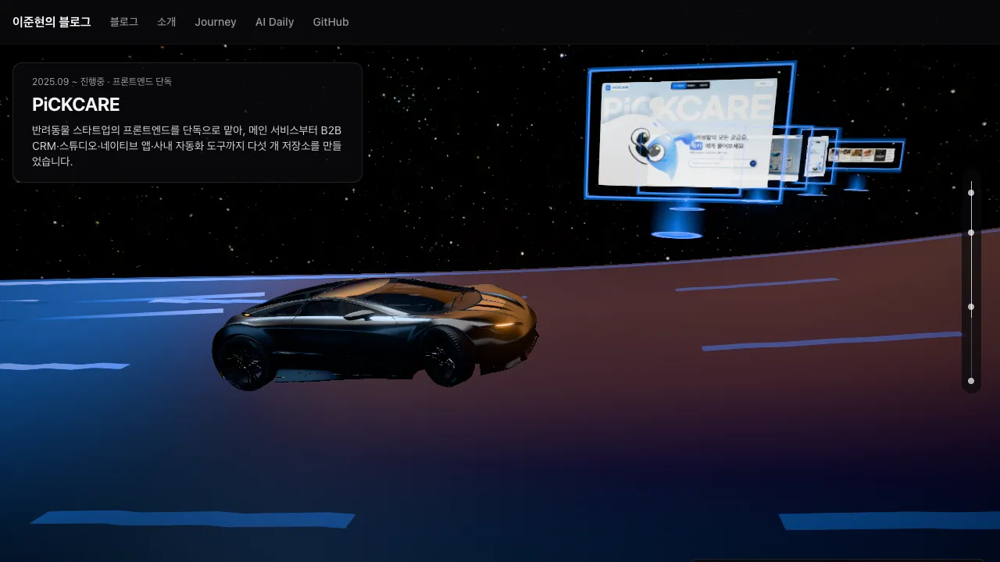
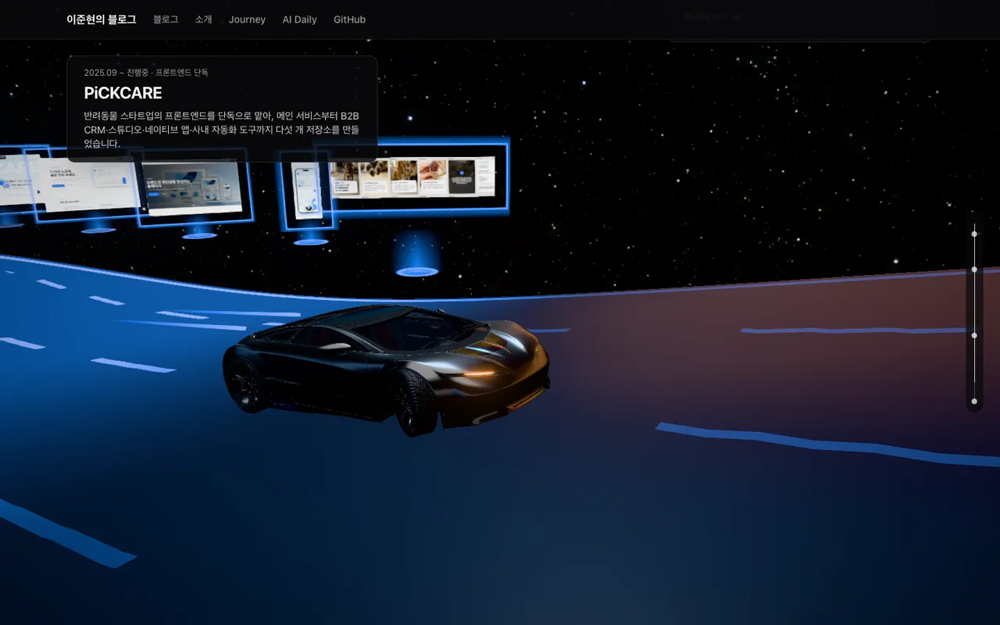
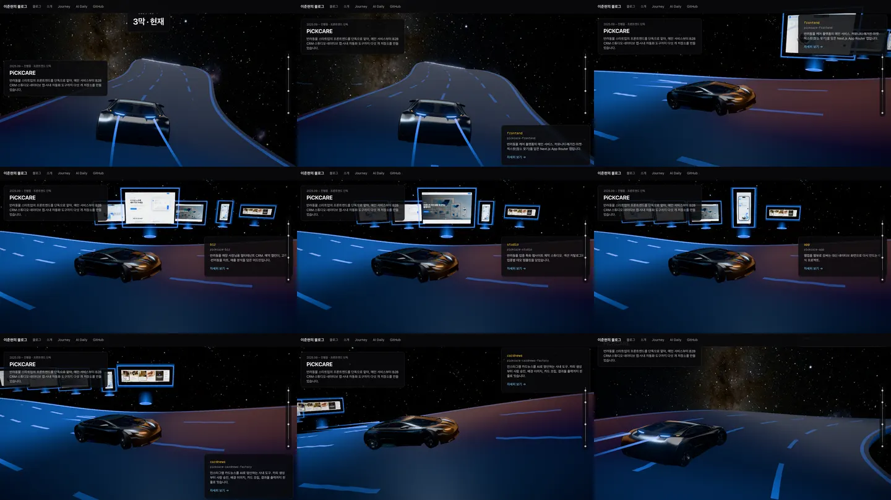
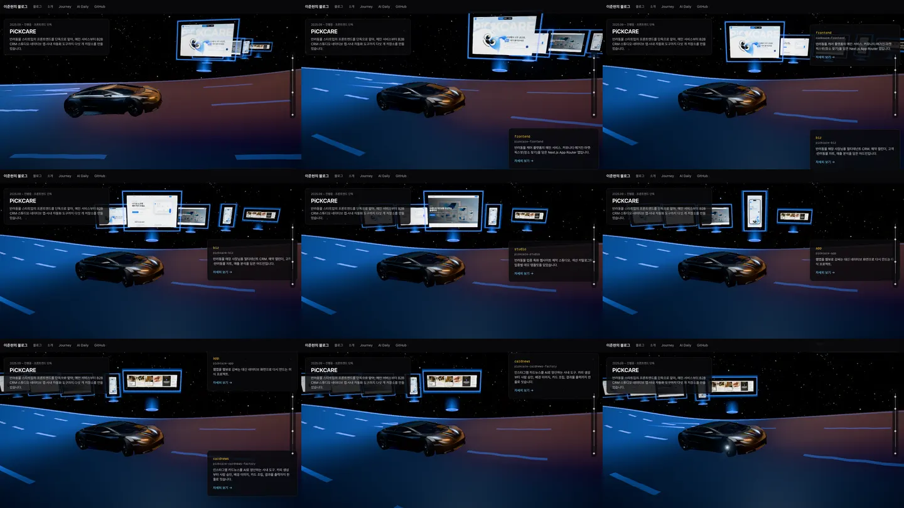
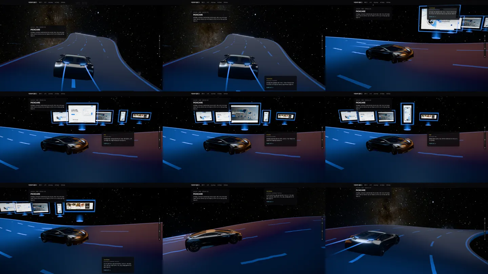
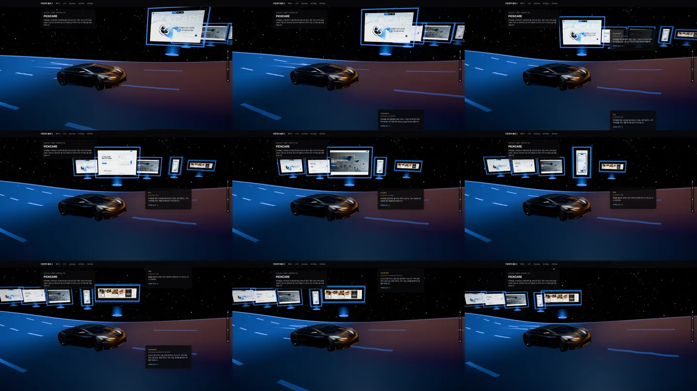
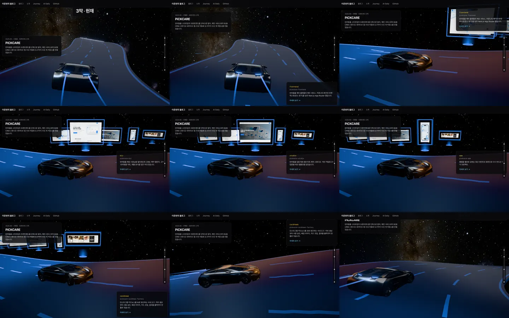
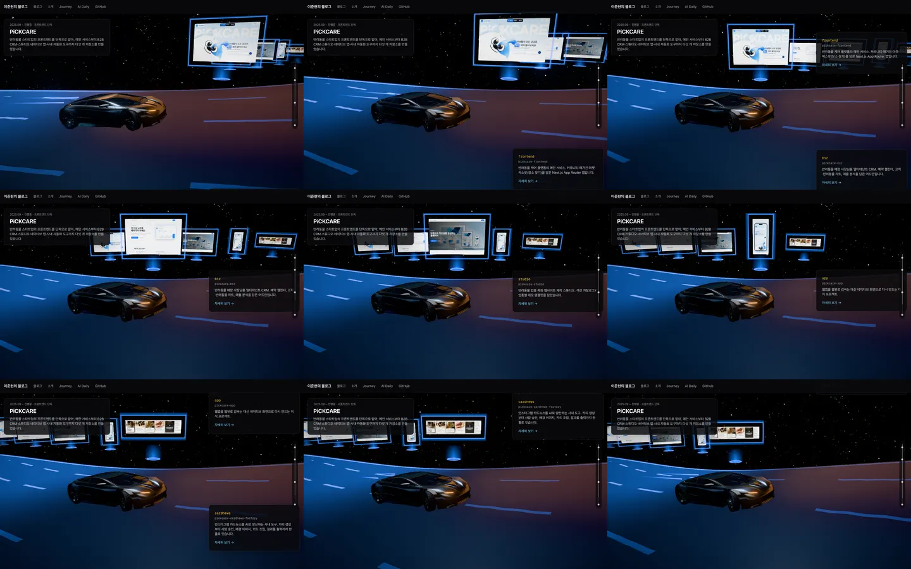
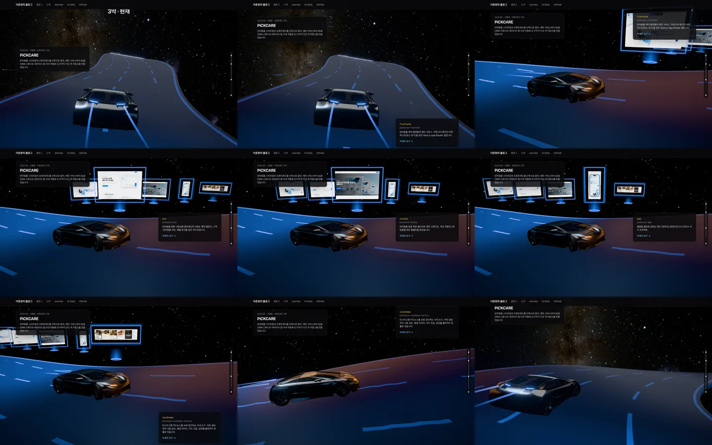
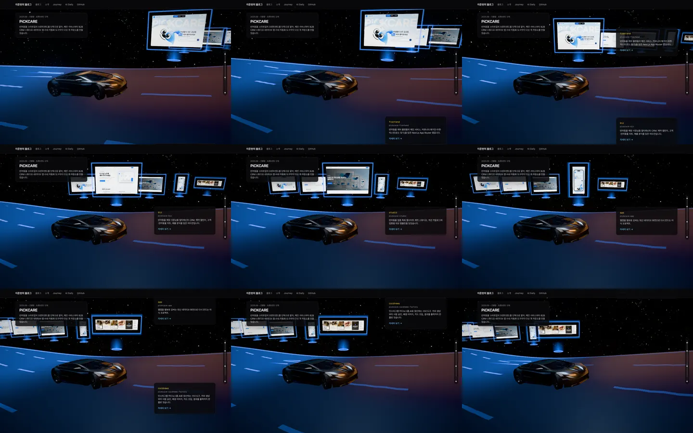

# 여정(Journey) 설계

2026-10-14 (2026-10-15 개정: 세계관을 "스페이스 드라이브"로 바꿈. 1·2·3·4·5·7·8·9·10절이 바뀌었다.
바뀐 결정과 이유는 9절에 있다)

2026-10-15 2차 개정: 2-3을 2-3a(제품 화면 홀로그램과 클릭)와 2-3b(막별 풍경)로 나누고 2-3a를
정했다. 2-2b 구현에서 정한 점과 텍스처 추정의 정정도 반영했다. 1·2·3·4·5·6·7·8·9·10절이
바뀌었다. 2026-10-16 2-3a 계획을 쓰며 사본에 구현·검증한 결과로 3절(홀로그램 수치, PiCKCARE 카메라,
cardnews 이미지, 다시 맞추기), 4절(esbuild), 7절(실측), 9·10절을 고쳤다.

2026-10-19 3차 개정: 2-3b(막별 풍경)를 정했다. 사본 시제품의 캡처로 정한 수치와 검증 기준을
1·2·3·4·7·8·9·10절에 반영했다. 여정은 막이 계속 늘어나므로 3막을 종착지로 전제하지 않는다(3절
"막별 풍경"). 같은 날 2-3b 계획을 쓰며 사본에 구현·검증한 결과로 1·3·4·8·9절을 고쳤다(도로 끝 연장선
폭 70m, 홀로그램 뒤 비우기의 기준 크기, 뺀 요소의 이유 기록, 가림 판정, 역방향 비교 방법, 모듈).

2026-10-19 4차 개정: 2-4를 2-4a(휴대폰 3D)·2-4b(강등과 2D 안전망)·2-4c(접근성·마감·병합)로 나누고
2-4a를 정했다. 사본 시제품(세로 화면 카메라와 아래 고정 카드)의 캡처와 투영 계산으로 정한 수치를
1·2·3·4·5·7·8·9·10절에 반영했다. 세계 속 차·홀로그램·풍경 자리와 데스크톱 화면은 바꾸지 않는다. 같은 날 2-4a 계획을
쓰며 사본에 구현·검증한 결과로 3·4·5·7·8·9절을 고쳤다(세로 카메라 감쇠와 정류장 구도, 경량 블룸 값, 헤더 간격, 고정 카드를
켜는 조건, 측정 오버레이, 렌즈 모듈). 2-4a 구현을 마치며 휴대폰 실측을 하지 않기로 하고(사용자 결정) 에뮬레이션에서
찾은 엔딩 패널 높이와 캔버스 틀 높이를 1·2·5·7·8·9·10절에 적었다.

2026-10-20 5차 개정: 2-4b(강등과 2D 안전망)를 정했다. 같은 본문을 모드 속성으로 바꾸는 2D 세로 타임라인, 세 단계 실행 중
강등(전체 → 경량 → 최소 → 2D), 컨텍스트 손실·장면 실패의 2D 전환, 진행 막대에 붙인 수동 전환과 자동 전환 알림, 움직임
줄이기의 범위, 2-4a에서 미룬 것 중 휴대폰 첫 화면·안전망·성능 넷을 1·2·4·5·8·9·10절에 반영했다.

## 1. 개요

블로그의 프로젝트 7개를 하나의 3D 공간으로 보여주는 포트폴리오 페이지 `/journey`.
콘셉트는 **A Journey Through Code**. 방문자가 스크롤하면 우주를 달리는 차가 2023년의 첫
프로젝트에서 현재의 PiCKCARE까지 나아가고, 프로젝트를 지날 때마다 그다음 길이 빛으로 열린다.
지나온 길에는 프로젝트의 색이 쌓인다. **마지막에 보여 주는 것은 차가 아니라 차가 지나오며
만든 빛의 길이다.** 프로젝트 하나하나가 다음으로 나아갈 길을 만들었다는 것이 이 페이지의
메시지다.

목표는 두 가지다.

- **이직·포트폴리오**: 채용 담당자에게 성장 과정과 실제 제품 역량이 남는 인상
- **공부**: three.js, 셰이더, 스크롤 연출을 최고 완성도로 직접 만드는 경험

세 요소를 역할별로 나눠 결합한다(2026-10-15 개정).

| 요소 | 역할 | 보여줄 가치 |
|---|---|---|
| 빛의 길 | 공간 전체 구조. 차가 나아가면 앞길이 열리고, 지나온 길에 프로젝트의 색이 쌓인다 | 프로젝트 하나하나가 다음 단계를 만든 성장 경로 |
| 차 | 스크롤에 따라 나아가는 주인공. 진행의 방향과 속도감 | 앞으로 나아가는 개발자 |
| 실제 제품 화면과 막별 풍경 | 길가에 떠오르는 대표 제품 화면(홀로그램)과 막마다 바뀌는 지형·도시 | 실제 제품을 만든 역량과 성장의 규모 |

원칙:

- **스크롤은 서사, 클릭은 탐색.** 스크롤만으로 처음부터 끝까지 이어진다. 상세를 보려고
  클릭하거나 카메라를 조작하도록 강요하지 않는다.
- **3D보다 실제 성과가 우선.** 3D 공간은 프로젝트를 설명하지 않는다. 실제 제품을 돋보이게
  하고 성장의 규모를 체감하게 한다. 상세 화면에는 제품 화면, 담당 범위, 기술적 의사결정,
  해결한 문제를 보여준다.
- **같은 진행률이면 같은 장면.** 차, 카메라, 열린 길, 색과 발광은 모두 스크롤 진행률 하나의
  순수 함수다. 위로 되돌아갔다 다시 와도 같은 장면이 나온다.
- **마지막 주인공은 길이다.** 차는 이야기를 끌고 가지만, 엔딩에서 시선의 중심은 지나온 빛의
  길 전체다.
- **3D는 공간과 카메라만.** 글은 처음부터 끝까지 진짜 HTML이다.
- **부드러움은 필수 조건이다.** 스크롤과 카메라가 매 프레임 끊김 없이 따라가야 한다.
  화질보다 부드러움이 먼저다.

### 비목표

- 서버, 데이터베이스, 외부 API. 정적 호스팅만으로 동작한다.
- 외부 3D 모델 파일. 예외는 차 모델 하나뿐이다(2026-10-15, 3절 "차"). 나머지 형태는 코드로
  만든다.
- 행성·궤도·기하학 도형을 늘어놓는 장면. 공학 시뮬레이션이나 기술 데모처럼 보인다.
- 실제 주행 시뮬레이션(물리). 차와 카메라는 진행률에 따라 보간한다. 바퀴는 진행률로 정해지는 달린 거리만큼
  구른다(3절 "차", 2026-10-16 사용자 요청).
- 블로그 글 디자인 통일. 각 글의 지금 모양을 그대로 유지한다.
- 블로그 글 목록(`src/data/posts.ts`) 변경
- 이력서 PDF
- 다국어

### 단계

| 단계 | 내용 | 통과 조건 |
|---|---|---|
| 1단계 | 블로그 프로젝트 글 7개의 내용을 데이터로 옮기고, 페이지가 데이터를 렌더링하게 바꾼다 | 리팩터링 전후 화면이 픽셀 단위로 같다 |
| 2단계 | 같은 데이터로 `/journey`를 만든다 | 7절 성능 기준과 8절 테스트 통과 |

구현 계획은 단계마다 따로 쓴다. 2단계 계획은 1단계가 끝난 뒤, 실제로 만들어진 데이터 타입을
바탕으로 쓴다. 1단계가 끝나야 2단계를 시작한다.

2단계는 계획 여럿으로 나눈다(2026-10-15 개정).

| 계획 | 내용 |
|---|---|
| 2-1 골격 (완료) | 스크롤 엔진, 정류장, 본문, 상세 패널, 진행 막대 |
| 2-2 시각 언어 (완료) | 셰이더 사전 컴파일, 장면 상태, 후처리, 막별 분위기, 은하 배경. 회랑·렌더 단계는 2-2b에서 퇴역 |
| 2-2b 길·차·궤적·카메라 (완료) | 이야기의 뼈대. 지형·홀로그램은 넣지 않는다 |
| 2-3a 제품 화면 홀로그램과 클릭 (완료) | 대표 제품 화면 11장의 홀로그램, 클릭·호버·링크 포커스, PiCKCARE 저장소 5개 표현, 썸네일 대체 |
| 2-3b 막별 풍경 (완료) | 1막 절벽, 2막 부유 암석, 3막 도시 스카이라인과 첨탑, 막 단위 등장. 헤드라이트 빛 웅덩이는 캡처를 보고 넣지 않기로 했다 |
| 2-4a 휴대폰 3D (완료, 실기기 미측정) | 기기 판별과 3D 경량, 세로 화면 구도(카메라·아래 고정 카드), 헤더·진행 막대, `?debug=perf`. 실제 휴대폰 측정은 하지 않고 에뮬레이션으로 대신했다(사용자 결정) |
| 2-4b 강등과 2D 안전망 | 실행 중 강등, WebGL 컨텍스트 손실 시 2D, 2D 세로 타임라인, 수동 전환, 움직임 줄이기 |
| 2-4c 접근성·마감·병합 | 접근성 검사, 데스크톱·휴대폰·2D 전환 회귀, 넘긴 다듬기, 성능 재측정, main 병합 |

2-4의 나눔(2026-10-19, 사용자 결정): 휴대폰으로 여는 채용 담당자의 첫인상을 먼저 바로잡고(2-4a), 그 위에
강등과 2D 안전망을 만든다(2-4b). 기기 판별은 처음 그릴 방식을 정하는 것이고, 실행 중 강등은 실제 성능
저하나 렌더러 실패에 대응하는 별도 기능이다. 3D와 2D는 정류장 순서·링크·진행 상태를 같은 데이터에서 읽는다.
2-4c에서 실제 기기 검증을 다시 한다(앞 단계의 테스트만으로 최종 완료를 선언하지 않는다).

**2-2b 완료 조건.** 겉보기가 멋진지만으로는 통과하지 않는다. 다음을 모두 만족해야 한다.

- `driveAt(p)`가 결정적이다. 같은 `p`면 같은 결과이고, 역스크롤 뒤 같은 장면으로 돌아온다.
- 열린 길의 경계와 발광, 궤적 색이 셰이더와 TypeScript에서 같은 기준으로 일치한다.
- 카메라가 정류장·엔딩 전환에서 끊기지 않고, 엔딩 내려다보기가 헤더·패널을 피하는 안전
  영역 안에 든다.
- 7절 성능 예산을 지킨다.
- 3D가 어떤 이유로 실패해도 본문·진행 막대·상세가 동작하고, 셰이더 컴파일 실패와 WebGL
  컨텍스트 손실은 감지해 장면 상태와 콘솔에 남긴다(복구는 2-4).

**2-3a 완료 조건.** 단위 테스트 통과만으로 완료하지 않는다. 최종 구현에서 다음을 모두 확인하고,
숫자와 캡처를 완료 보고에 남긴다.

- `hologramsAt(p)`가 결정적이다. 같은 `p`(와 같은 상세 해시)면 같은 결과이고, 역스크롤 뒤 같은
  장면으로 돌아온다.
- 1막 홀로그램은 고정 방향, 2·3막은 실제 카메라를 향한다. 16:9·16:10 화면에서 헤더·패널을 피하는
  안전 영역 안에 들고, 차·카메라와 겹치지 않는다. 엔딩에서 빛 원반 속으로 사라진다.
- 원래 색은 서로 대신할 수 없는 세 검증을 모두 통과한다. ① 화면 영역은 발광하지 않는다(실제
  재질을 톤 매핑 없이 그리면 층 이미지와 ΔE 0). ② 테두리·후광의 최대 휘도가 모든 궤적 색과
  쉬는 때·호버에서 1(블룸 문턱) 미만이다(단위). ③ 실제 장면의 막별 대표 시점에서 블룸을 켜고 끈
  차이가 화면 영역 안에서 평균 ΔE 2 이하다(캡처, 주변 발광 포함).
- 실패 경로를 각각 확인한다. 이미지 한 장 404, 이미지 전부 404, 텍스처 배열 생성 실패(GPU 업로드
  오류 주입). 셋 모두 장면이 실패 상태로 가지 않고, 썸네일은 3절 규칙대로 보이며, 끝까지
  스크롤된다. WebGL이 없는 환경과 실행 중 장면이 실패한 환경에서도 썸네일이 보이고 스크롤된다.
- 3절 "홀로그램 상호작용"의 e2e를 모두 통과한다(클릭 대상 일치, 커서, 링크 포커스, 중복 기록 없음,
  포커스 복귀, PiCKCARE 앞줄, 썸네일 낭독 1회).
- 7절 예산을 최종 구현에서 다시 잰다. `perf:journey` 3회 결과, 드로콜, 준비 전후의 셰이더
  프로그램 수, 텍스처 GPU 추정치, 홀로그램 파일 합계와 네트워크 전송량, 막별 캡처를 남긴다.

**2-3b 완료 조건.** 단위 테스트 통과만으로 완료하지 않는다. 최종 구현에서 다음을 모두 확인하고,
숫자와 캡처를 완료 보고에 남긴다.

- 배치가 결정적이다. 시드·도로·막별 설정이 같으면 같은 정점이 나온다. 지오메트리는 처음 한 번만
  만들고, 스크롤해도 지오메트리 버전이 바뀌지 않는다. 매 프레임에는 uniform만 바뀐다.
- 3절 "막별 풍경"의 자리 규칙을 단위 테스트로 지킨다. 모든 풍경 정점은 모든 도로 표본에서 수평
  40m 이상 떨어진다(첨탑은 100m 이상). 도로 끝 연장선 양옆 70m 안에는 풍경이 없다.
- 가림이 없다. 정류장 홀로그램의 네 모서리와 열린 도로 표본을 향하는 광선이 풍경에 막히지 않는다.
  순수 함수의 상자 판정과, 실제 three 카메라로 하는 e2e·캡처(정류장 회전·엔딩 포함)를 모두
  통과한다.
- 빛을 확인한다.
  - 최대 휘도는 0.35다(단위).
  - 막 경계에서 풍경 색이 `trailColor`와 같다(단위).
  - 켜짐이 위치로 정해져 정방향과 역방향의 결과가 같다(단위, 역순 캡처 비교).
  - 블룸을 켜고 끈 막별 대표 시점 비교에서 홀로그램 화면 영역의 평균 ΔE 2 이하를 다시
    지킨다(`check:holograms` 확장).
- 막 단위 등장을 확인한다. 두 막 앞은 그리지 않고 바로 다음 막은 어두운 실루엣이다(단위, 캡처).
  1막 화면에 3막 도시가 없다.
- 첨탑이 3막 제목·진입 주행·도착·떠날 때 화면 안에 서고(투영 테스트), 실제 소개 카드 사각형과
  겹치지 않는다(16:10·16:9 e2e와 캡처).
- 엔딩에서는 도로 전체의 형태가 먼저 읽히고, 블룸이나 안개가 과하지 않다(캡처).
- PiCKCARE의 허용된 결함 두 장면(3절 "본문 저장소 패널 구간")을 캡처로 다시 확인한다.
- 7절 예산을 다시 잰다. `perf:journey` 3회(회마다 50ms 초과 0, 실행 환경과 주사율을 함께 기록),
  가장 무거운 프레임의 드로콜, 준비 전후 셰이더 프로그램 수, 텍스처, `?debug=stats`의 풍경
  메시별 드로콜을 남긴다.

**2-4a 완료 조건.** 캡처와 단위 테스트만으로 완료하지 않는다. 실제 휴대폰 측정은 따로 하는 완료 조건이다.
숫자와 캡처를 완료 보고에 남긴다.

- 휴대폰 실측(7절 "2-4a 기준"): 아이폰(Safari)과 안드로이드(Chrome) 각각 30fps를 지킨다. 한쪽만 재면
  다른 쪽은 미검증으로 적는다. 맥에서 한 에뮬레이션과 섞지 않는다.
  - 2026-10-19 사용자 결정: 휴대폰 실측은 하지 않고 잘 되게 구현만 한다. 그래서 두 기기 모두 미검증이다. 대신 맥에서
    창 없는 에뮬레이션(WebKit 아이폰 14, Chromium Pixel 7 터치, CPU 4배 느리게)으로 판별·고정 카드·누르기·오류·프레임
    시간을 보고, 숫자는 7절 "2-4a 최종"에 실측과 나눠 적는다. 실제 기기에서 30fps를 못 지키는지는 2-4b의 실행 중
    강등이 받는다.
- 세로 화면 구도(3절 "세로 화면"): 네 크기(390×844, 360×800, 430×932, 820×1180)의 정류장 읽기
  자리(정류장 30~70%)에서 차 몸통 전체와 홀로그램 그림 영역 전체가 헤더 아래이고 화면 위 60% 안이다
  (투영 단위 테스트와 캡처). 네 크기의 주요 정류장과 엔딩 캡처를 남긴다.
- 전환: PFPlay에서 주행 시점으로 돌아오는 전환을 따로 검증한다. 60Hz·120Hz로 앞뒤 빠르게 스크롤하는
  시뮬레이션에서 프레임마다 차 몸통이 화면 높이의 35% 이하이고 차 가운데가 x 0.15~0.85다.
- 가림 없음: 세로 카메라에서도 풍경이 홀로그램 네 모서리와 열린 도로를 가리지 않는다(e2e 레이캐스트).
- 아래 고정 카드(e2e): 정류장마다 그 카드만 보인다. PiCKCARE에서 카드의 저장소가 홀로그램 앞줄과 늘 같다.
  엔딩에서는 고정 자리가 비고 연락처만 스크롤된다. Tab·Shift+Tab을 차례로 눌러도 포커스한 링크의 카드가
  보이고, 스크롤이 멈춘 뒤 포커스와 스크롤이 다시 움직이지 않는다.
- PiCKCARE 저장소 패널 배치 e2e를 mobile에서 다시 켠다. 허용된 결함 두 장면(3절 "본문 저장소 패널 구간")은
  회귀만 확인하고 이번 단계에서 디자인을 바꾸지 않는다.
- 기기 판별과 경량(5절): 판별 규칙 단위 테스트(Safari처럼 값이 없는 경우 포함). `?debug=stats&tier=lite`에서
  해상도 배율 1.5 이하, 은하 2048×1024, 블룸 축소, 텍스처 추정 약 34.8MiB. 준비 뒤 새 셰이더 프로그램 0,
  드로콜 60 이하. 2D 판정에서는 3D 코드와 은하를 내려받지 않는다.
- 헤더·진행 막대: 360·390px에서 헤더가 한 줄이다. 세로 화면에서 진행 막대가 헤더 아래 가로이고 정류장
  건너뛰기가 동작한다. 블로그 글 모바일 기준 이미지는 높이·DOM·마크업이 같음을 확인한 뒤 의도한 변경으로
  다시 찍는다(8절 2항).
- 데스크톱 회귀: 기존 e2e·단위·`check:holograms`·역방향 비교가 그대로 통과하고, 데스크톱 풍경 12장면 캡처가
  2-3b 완료 때와 같다.

**2-4b 완료 조건(2026-10-20).** 3D가 실패하거나 성능이 낮은 환경에서도 프로젝트 정보와 탐색 기능을 계속 쓸 수
있다. 단위 테스트와 캡처만으로 완료하지 않고, 아래를 모두 e2e와 숫자로 확인해 완료 보고에 남긴다.

- 2D만으로 쓸 수 있다: 3D 없이 모든 정류장 카드, 상세(휴대폰에서 아래에서 올라오는 시트), 링크, 연락처, 막 탭,
  공유 주소(`#pfplay` 등)가 동작한다. 빈 스크롤이 없다. 휴대폰(412×839) 2D 문서 높이가 내용 높이가 되어 지금(3D 배치
  그대로, 18.7화면)의 절반 이하다(5절 "2D 레이아웃").
- 실행 중 강등이 정해진 단계대로 한 방향으로만 내려가고(5절), 보던 정류장을 지키며, 2D로 바뀔 때 알림이 한 번
  나온다.
- 컨텍스트 손실과 장면 실패는 2D로 바꾸고, "3D로 보기"로 장면이 다시 준비된다. 다시 준비된 뒤 우리가 내린
  렌더러의 손실 때문에 2D로 되돌아가지 않는다.
- 수동 전환이 선택을 기억하고, 2D를 기억한 방문자는 처음 그릴 때 배치가 튀지 않는다.
- 움직임 줄이기에서 5절의 항목이 꺼진다.
- `next dev`에서 장면이 준비된다(10절에서 넘어온 것).
- 2-4a에서 미룬 넷(입구 카드 자리, 세로 화면 로딩 줄, 캔버스 높이 대체값, 세로 카메라 계산)을 고친다.
- 회귀가 없다: 기존 단위·e2e, 데스크톱 풍경 12장면 캡처(장면마다 0.05% 이하), `check:holograms`, `perf:journey`.

**2-4c 완료 조건(요지, 계획에서 자세히 정한다).** 주요 기기와 전환 경로(데스크톱·휴대폰·2D 전환)를 다시
검증하고, 알려진 결함과 미완료 항목을 정리한 뒤 main에 병합한다. 실기기 재검증을 할지는 2-4c 계획 때 정한다
(2-4a는 사용자 결정으로 실측하지 않았다).

### 관련 정리 (완료)

`/playground`와 데모 5개는 삭제했다(`452a9c7`). 3D 쇼케이스 역할은 `/journey`가 맡는다.
앞으로 만들 3D 데모(셰이더 아트, 절차적 지형, 물리 장난감)는 데모가 들어간 블로그 글로
만들며, 각각 별도 설계로 진행한다.

## 2. 사용자 경험

### 진입 경로

- 주소: `/journey`
- 헤더 메뉴에 `Journey` 링크를 둔다. 블로그 · 소개 · Journey · AI Daily · GitHub 순서다.
- 홈 소개 문단의 링크 줄(GitHub | 이메일 | About)에 Journey를 추가한다.
- About 페이지 "소개" 섹션 끝에 Journey로 가는 링크를 둔다.

### 세 막

| 막 | 기간 | 프로젝트 | 빛 | 공간 | 상세 |
|---|---|---|---|---|---|
| 1막 "시작" | 2023.04 ~ 2023.10 | 코코아톡, Todo App, EUTCHA | 주황 | 주황빛 절벽 도로. 길이 차의 움직임에 맞춰 생겨나고, 주변은 단순하게 둬 출발의 느낌을 살린다. 지나가며 본다 | 코코아톡은 캡션만. Todo·EUTCHA는 가벼운 상세 |
| 2막 "협업" | 2023.09 ~ 2025.02 | Stock2U, Tix2U, PFPlay | 주황 → 보라 → 파랑 | 길이 부유하는 암석 지대 사이로 넓어지고 공간의 규모가 커진다. 멈춰서 본다 | 전체 상세 |
| 3막 "현재" | 2025.09 ~ | PiCKCARE | 파랑 | 지평선 위로 푸른 미래 도시의 스카이라인이 깔리고, 길이 사라지는 곳에 첨탑이 선다. 지나온 궤적이 하나의 큰 길로 이어진다. 가장 오래 머문다 | 저장소 5개별 상세 |

길의 폭, 빛의 색, 주변 공간의 규모가 막마다 커지므로 스크롤만 해도 성장 서사가 전달된다.
길만 길어지는 것이 아니라 공간 자체가 바뀐다(2026-10-15 개정).

### 정류장과 스크롤 배분

여정 전체를 정류장 목록 하나로 정의한다. 단위는 화면 높이(vh)다.

| 정류장 | 길이 | 고정(pin) | 연출 |
|---|---|---|---|
| 입구 | 1 | | 제목. 차가 출발선에 서 있다. 셰이더 컴파일 중 로딩 표시 |
| 1막 진입 | 0.5 | | 막 제목. 주황빛 길이 열리기 시작한다 |
| 코코아톡 | 1 | | 차가 길가에 서 있는 대표 제품 화면(홀로그램)을 지나치고(2-3a), 길이 그만큼 앞으로 열린다 |
| Todo App | 1 | | 〃 |
| EUTCHA | 1 | | 〃 |
| 2막 진입 | 0.5 | | 궤적에 보라가 섞이기 시작하고 길이 넓어진다 |
| Stock2U | 2 | ✓ | 차가 들어와 멈추면 길가 빛 원반에서 제품 화면이 떠오르고(2-3a), 머무는 동안 요약 패널과 함께 보며 다음 정류장까지 길이 열린다. 출발하면 화면이 내려간다 |
| Tix2U | 2 | ✓ | 〃 |
| PFPlay | 2 | ✓ | 〃 |
| 3막 진입 | 0.5 | | 지평선 위로 낮은 도시 스카이라인이, 길이 사라지는 곳에 첨탑이 보이고, 길이 거대한 길로 넓어진다 |
| PiCKCARE | 5 | ✓ | 저장소 다섯의 화면이 늘어서고, 본문의 지금 저장소가 가운데로 와 커지며 앞으로 나온다(2-3a). 저장소 패널은 앞에서 1.2화면 뒤부터 뒤에서 0.7화면 앞까지 지나간다(차가 들어오고 떠나는 동안은 비운다, 3절 "PiCKCARE 앞줄"). 도시와 첨탑은 들어올 때와 떠날 때 보이고, 머무는 동안에는 화면에 들어오지 않는다(3절 "막별 풍경") |
| 엔딩 | 2 | | 카메라가 위로 오르며 차가 지나온 빛의 길 전체를 내려다본다. 연락처와 최근 글 |

합계 18.5화면, 천천히 스크롤하면 1분 남짓이다. 도로는 굽이·높낮이·뱅킹이 있는 우주 도로다.
아직 열리지 않은 길은 보이지 않고, 다음 막은 안개 너머 실루엣으로만 보인다(2026-10-15 개정). 두 막
앞의 풍경은 보이지 않는다(2-3b).

프로젝트 순서는 **종료일 기준**이다. 시작일로 정렬하면 Stock2U(2023.09.21 시작)가
EUTCHA(2023.09.28 시작)보다 앞서 막 구분이 깨진다. 종료일 기준이면 EUTCHA(10.09 종료) →
Stock2U(11.16 종료)로 막 순서와 일치하고, 블로그 목록(`sortByDateDesc`)과도 같은 기준이다.

### 상세 화면

- 오른쪽 패널로 열린다. 3D(차와 길, 제품 화면)는 패널 뒤에 맥락으로 남는다.
- 일반 프로젝트: 헤더(기간 · 팀 · 한 줄 요약 · 기술 · 링크) → 제품 화면 → 담당 역할 → 성과
  → "블로그 원문 보기".
- PiCKCARE: 저장소별 탭(frontend · biz · studio · app · cardnews)과 케이스 아코디언.
  첫 케이스만 펼친다. 탭을 바꾸면 3D에서도 해당 저장소의 화면이 앞으로 나온다(2-3a, 3절).
- 열기: 본문 패널의 "자세히 보기" 링크, 또는 길가 제품 화면(홀로그램) 클릭. 홀로그램 클릭은
  짝인 링크를 눌러 같은 흐름으로 연다. 키보드의 길은 링크다(2-3a, 3절 "홀로그램 상호작용").
- 닫기: 닫기 버튼, ESC, 패널 바깥 클릭, 브라우저 뒤로 가기.
- 열려 있는 동안 페이지 스크롤(Lenis)을 멈추고 패널 안에서만 스크롤한다. 닫으면 원래
  위치로 돌아간다.
- 공유 주소: `/journey#<slug>`. 이 주소로 들어오면 해당 정류장으로 이동한 뒤 패널을 연다.
  열 때 `history.pushState`로 기록해서 뒤로 가기로 닫힌다.
- 접근성: 대화상자 역할을 알리고, 열리면 포커스를 패널로 옮겨 가두고, 닫으면 연 버튼으로
  되돌린다.
- Stock2U · Tix2U의 썸네일(폭 약 720px)은 폭 360px 이하로만 보여 레티나에서도 선명하게 한다.
- 2막 본문 패널의 썸네일은 그 프로젝트의 제품 화면이 3D 홀로그램으로 켜져 있을 때 화면에서만
  감춘다(2-3a, 3절 "썸네일 대체"). 3D가 없거나 실패하면 그대로 보인다.

### 엔딩

- 주 행동: 이메일 복사 버튼(`one31798883@gmail.com`)과 GitHub 링크. 복사가 실패하면 주소를
  선택된 상태로 보여준다.
- 보조: 최근 기술 글 3개(`sortedPosts` 중 `category: "post"` 상위 3개).
- 패널은 스크롤 끝에서 위끝이 헤더(3.5rem, 세로 화면은 진행 막대까지 5rem)보다 0.5rem 아래에 오도록 높이를 화면에
  맞추고, 넘치면 패널 안에서 스크롤한다. 휠은 그 방향으로 더 굴릴 수 있는 패널이 받고 끝에 닿으면 페이지가 굴러간다(Lenis
  `allowNestedScroll`). 데스크톱 패널(약 490px)은 창 안쪽 높이가 약 610px보다 낮을 때 넘친다(1280×720 노트북 창 등).
  아래 여백은 넓은 화면 10svh, 세로 화면 5svh(고정 카드와 같다). 짧은 휴대폰
  화면(아이폰 사파리 도구 막대가 펴진 390×664, 아이폰 SE 375×548, 휴대폰 가로 750×340)에서 연락처 제목과 이메일이
  헤더 밑이나 화면 위로 숨었다(2-4a 에뮬레이션, 2026-10-19).

### 진행 표시

화면 가장자리에 막 표시가 있는 진행 막대를 둔다. 누르면 해당 막으로 부드럽게 이동한다
(`lenis.scrollTo`). 채용 담당자가 PiCKCARE로 바로 건너뛸 수 있다. 2D 모드에서는 상단에
고정된 막 탭으로 바뀐다. 세로 화면(3D)에서는 헤더 바로 아래의 화면 폭 가로 막대(선과 정류장 점, 누르는
자리 높이 24px)로 둔다(2-4a). 오른쪽 세로 막대는 세로 화면에서 3D 위쪽 영역의 가장자리에 걸린다.

2-4b(2026-10-20, 사용자 결정): 2D의 막 탭은 화면 폭과 관계없이 헤더 바로 아래 가로 줄이다(시작·협업·현재·연락처).
지금 읽는 막에 `aria-current`를 단다. 2D는 진행률과 정류장 길이가 맞지 않으므로 섹션이 화면의 읽는 자리에 들어왔는지로
고른다. 수동 전환 버튼은 새로 띄우는 요소 없이 진행 막대 끝에 붙인다. 데스크톱 3D는 오른쪽 세로 막대 아래 끝("2D로 보기"),
세로 화면 3D는 가로 막대 오른쪽 끝, 2D는 막 탭 오른쪽 끝("3D로 보기")이다. 자동으로 2D가 될 때의 알림도 그 옆에 뜬다.
아래 고정 카드 자리와 3D 위쪽 60%를 가리지 않는다. WebGL2가 없는 기기에는 버튼을 두지 않는다.

## 3. 시각 언어

2026-10-15에 다시 썼다. 2-2까지의 "렌더 단계(청사진 → 클레이 → 완성품)", "추상 조형
오브젝트 7종", "회랑과 원형 전시실"은 폐기했다(9절). 2-2에서 만든 셰이더 기반(노이즈를 따라
빛나는 경계, 사전 컴파일, 후처리, 막별 분위기, 은하 배경)은 아래 규칙으로 다시 쓴다.

### 진행률 하나

순수 함수 `driveAt(p)`가 스크롤 진행률 `p`(0~1)에서 다음을 계산한다. 프레임마다 쌓는 값이
없어 같은 `p`면 같은 결과다.

- **차**: 도로 위 거리 `carS`. 프로젝트 정류장에서는 들어와 멈추고, 머물고, 다시 출발하는
  감속 곡선을 따른다(2-1의 고정 구간 곡선). 자세는 그 자리 도로의 위치·방향·뱅킹이다.
- **열린 끝** `revealS`: 평소에는 차 앞 일정 거리(초안 30m)까지 열려 있다. 정류장에 머무는 동안 그
  구간의 진행률에 맞춰 다음 정류장까지 부드럽게 열린다("프로젝트를 완성하면 다음 길이
  생긴다"). 진행에 따라 뒤로 물러나지 않고, 차와 늘 최소 간격(12m 안팎, 차 길이의 약 2.5배)
  이상 떨어져 있다.
- **카메라 목표**: 아래 "카메라".

`s`는 도로 중심선을 따라 누적한 거리다. 좌우 가장자리도 같은 `s`를 공유하고, 굽이와
높낮이에서도 거꾸로 가거나 끊기지 않는다. 경로는 위치·접선·곡률·뱅킹이 이어지는 곡선이다.

### 길이 열린다, 색이 쌓인다

도로는 공중에 뜬 얇은 판(윗면과 옆면)이다. 폭은 1막 6m에서 2막에 넓어져 3막 16m의 거대한
길이 된다. 차선과 가장자리 선은 셰이더가 그린다.

| 구간 | 모습 |
|---|---|
| 아직 열리지 않은 길 | 없음(우주). 열린 끝에만 노이즈를 따라 빛나는 경계선이 흐른다 |
| 열렸지만 차가 지나지 않은 길 | 어두운 메탈 노면, 희미한 발광 |
| 차가 지나간 길 | 선명한 발광. 차 바로 뒤에서 서서히 차오른다 |
| 엔딩 | 열린 길 전체가 발광 |

색과 발광은 따로 계산한다. `trailColor(s)`는 길 위치의 색(1막 주황 `#ff7a1a`, 2막 주황 → 보라
`#b14cff` → 파랑 점진 전환, 3막 파랑 `#2f8cff`)이고, `glow(s, carS, ending)`는 위 표의 세기다. 전환 구간의 시작·끝과 보간식은
TypeScript 모듈 한 곳에 두고 셰이더는 같은 상수와 같은 식을 받는다. 셰이더 경계의 노이즈는
월드 좌표가 아니라 도로 좌표(s, 옆 거리)로 계산해, 경계가 움직여도 무늬가 미끄러지지 않는다.

### 차

- 모델: Khronos glTF Sample Assets의 **Car Concept**(© 2024 Darmstadt Graphics Group,
  CC BY 4.0). 웹용 압축본(Draco + KTX2, 약 3.4MB)을 바탕으로 Khronos 로고 메시·텍스처를 빼고
  (상표), 재질 변형 중 다크 메탈릭 도장 하나만 남긴다. 유리 투과 재질은 측정 뒤 무거우면 가벼운
  반투명 재질로 바꾼다. Draco·Basis 디코더는 CDN이 아니라 `public/`에서 내보낸다. 출처는 은하
  출처 옆에 적는다.
- 불빛:

  | | 헤드라이트 | 테일라이트 | 궤적 |
  |---|---|---|---|
  | 1막 | 주황 | 주황 | 주황 |
  | 2막 | 주황 | 주황 → 보라 → 파랑 | 점진 전환 |
  | 3막 | 주황 | 파랑 | 파랑 |
  | 엔딩 | 보조(어둡게) | 보조(어둡게) | 길 전체가 시각의 중심 |

  테일라이트 색은 `trailColor(carS)`다. 헤드라이트는 실제 광원 없이 발광 재질과 블룸으로
  표현한다(광원 수가 바뀌면 셰이더를 다시 컴파일한다). 노면의 빛 웅덩이는 넣지 않는다(2-3b 캡처,
  2026-10-19). 켜면 차 앞 노면이 회색으로 씻겨 1막의 주황이 흐려지고, 웅덩이는 대부분 차에
  가려진다. 꺼도 가장자리 선과 차선으로 도로가 읽힌다.
- 빛줄기: 테일라이트 두 곳에서 도로를 따라 짧은 빛줄기가 뒤로 남는다. 매 프레임 도로 곡률을
  따라 다시 그린다. 길이는 스크롤 속도가 아니라 `p`에서 정해지는 주행 속도 곡선으로 정해, 정류장
  전부터 연속으로 짧아지고 출발하며 다시 길어진다.
- 바퀴(2026-10-16, 사용자 요청): 스크롤하면 바퀴가 달린 거리(`carS`, m) ÷ 반지름만큼 구른다. 위로
  스크롤하면 거꾸로 돌고, 정류장에서 차가 멈추면 바퀴도 멈춘다. 휠·브레이크 디스크·타이어가 돌고
  캘리퍼는 차체에 붙어 남는다. 중심은 바퀴 노드의 원점, 축은 바퀴 노드의 x(앞으로 구르도록 늘 왼쪽을
  향하게)다. 모델의 앞바퀴는 수직축으로 약 30° 꺾인 자세라 꺾인 축 둘레로 돈다(조향은 하지 않는다).
  재질별로 합친 메시를 그대로 두고 정점 셰이더가 바퀴 정점만 돌린다. 정점마다 바퀴 중심·반지름·축을
  두고 매 프레임 거리 uniform 하나만 바꾼다. 드로콜은 46 그대로이고, 셰이더 프로그램은 준비 때
  28 → 30(돌아가는 바퀴 재질의 프로그램이 따로), 준비 뒤 증가 0이다.
- 실패: 차 전용 오류 경계가 모델·디코더 실패를 잡아 빛으로 그린 간결한 실루엣으로 바꾼다.
  실루엣도 같은 `driveAt(p)` 자세를 쓴다. 성능 때문에 실루엣으로 낮추는 일은 2-4의 실행 중
  강등에서만 한다.

### 카메라

- 주행: 차 뒤 약 7m, 위 약 2.4m에서 차 앞 약 10m 지점을 본다.
- 정류장: 차의 비스듬한 앞옆으로 돌아 차와 길가 한쪽(2-3a의 제품 화면 자리)을 함께 담는다.
  HTML 패널은 반대편이다. 프로젝트 정류장은 구간 앞뒤 1/4에서 돌고(머무는 정도와 같다), PiCKCARE는
  구간 앞뒤 12%에서 돈다(`viewWeight`, 사용자 결정 2026-10-16). 다섯 화면에 걸친 저장소 패널이 각자
  보이는 동안 홀로그램 줄이 화면에 있게 하려는 것이고, 차의 움직임은 그대로다. 본문 저장소 패널도
  차가 거의 다 들어온 뒤부터 떠나기 시작할 때까지로 좁혔다(아래 "PiCKCARE 앞줄", 2026-10-16).
- 엔딩: 상승과 회전을 함께 보간하며 길 전체를 내려다본다. 헤더와 연락처 패널을 피하는 안전
  영역 안에 길 전체가 든다(화면 비율별 테스트).
- 위치와 시선을 모두 프레임 간격 기반 감쇠로 따라간다. 노면 아래로 파고들지 않고(노면 위 1m
  이상), 주행 중에는 늘 차 뒤에 있다.
- 세로 화면은 다른 목표 자세와 렌즈를 쓴다(아래 "세로 화면 (2-4a)"). 위 수치는 가로 화면의 것이다.

### 막별 분위기

조명·안개 색·은하 밝기는 진행률의 순수 함수로 보간한다.

- 1막: 따뜻한 주황빛, 주황 기운의 안개
- 2막: 주황에서 파랑으로 이어지는 혼합 조명
- 3막: 푸른빛과 미래 도시의 분위기
- 엔딩: 주변은 어둡게, 은하와 완성된 빛의 길을 강조

### 배경: 우주

세 막과 엔딩의 배경은 모두 우주다(사용자 결정, 2026-10-15). 사이트 공통 배경의 떠다니는 별
먼지와 이어진다.

- 하늘 전체에 NASA SVS "Deep Star Maps 2020"(`starmap_2020_4k`)의 은하수 사진을 두른다.
  EXR 원본을 sRGB WebP(4096×2048, 약 1.6MB)로 바꿔 `public/journey/galaxy.webp`에 둔다.
  변환은 `scripts/build-galaxy.ts`가 한다. 생성한 은하와 비교해 사진을 골랐다.
- 길 주변에 별 먼지가 천천히 떠다닌다(코드로 만든 점). 차와 카메라가 지나는 길에서는 비켜 둔다.
- 출처를 엔딩 아래에 작게 적는다: NASA/Goddard Space Flight Center Scientific Visualization
  Studio, Gaia DR2: ESA/Gaia/DPAC.

### 후처리

블룸(빛의 길, 경계선, 차 불빛), Neutral 톤 매핑, 안티에일리어싱(SMAA), 약한 비네트만 쓴다.
밝기 1을 넘는 발광에 블룸이 걸리지만, 색 공간·톤 매핑·임계값에 따라 달라지므로 캡처로
확인한다. 엔딩에서 길 전체가 켜져도 블룸이 길의 형태와 곡선을 뭉개지 않아야 한다.

블룸의 문턱은 휘도 1~1.2 사이에서 켜진다(postprocessing 6.38 `smoothstep(1, 1.2, l)`).
홀로그램 화면은 발광하지 않고, 테두리·후광도 이 문턱 아래에 둔다(아래 "제품 화면 홀로그램").
톤 매핑은 장면 전체와 같이 화면에도 걸려 조금 어두워진다(시제품에서 평균 ΔE 2.2~5.2, 세
채널이 같은 정도라 색조는 유지). 따로 보정하지 않는다(9절).

### 제품 화면 홀로그램 (2-3a)

프로젝트마다 대표 화면 한 장만 3D 공간에 홀로그램으로 둔다. 설명과 기술 스택은 HTML 패널에
둔다. 홀로그램은 11개다: 1막 코코아톡·Todo App·EUTCHA, 2막 Stock2U·Tix2U·PFPlay, 3막 PiCKCARE
저장소 frontend·biz·studio·app·cardnews.

**모습.** 원래 색의 화면 + 막 색 빛 테두리 + 길가 빛 원반에서 올라오는 아주 약한 빛기둥.
테두리·빛기둥·원반의 색은 그 자리의 `trailColor`다. 화면에는 궤적 색을 섞지 않는다.

**쓰는 이미지.** 프로젝트의 홈 화면 캡처(`public/projects/<slug>/home.webp`)가 있으면 그것,
없으면(코코아톡·Stock2U·Tix2U) 썸네일이다. PiCKCARE는 저장소마다 첫 화면이고(cardnews는 첫 장이
빈 틀인 마스터 4종이라 완성 세트 `set-1`), app은 App Store 공식 스크린샷의 홈 화면이다(6절). Todo App은 가운데 카드만 잘라 쓴다. 홀로그램마다 쓸 원본과
잘라 쓸 영역은 데이터가 아니라 `holograms.ts`가 정한다(6절 "3D 정보를 담지 않는다").

**자리와 연출.** 수치는 시안에서 출발해 안전 영역·겹침 테스트로 맞춘 값이다(2026-10-16, 2-3a
계획). `s0`는 정류장 가운데 진행률의 차 자리, 옆 방향은 그 정류장의 오브젝트 쪽
(`objectSide`, 본문 패널 반대편)이다.

| 막 | 자리 | 방향 | 나타남 |
|---|---|---|---|
| 1막 | `s0 + 6m`, 길가 바깥 4.5m, 화면 가운데 높이 3.4m, 층 상자 6 × 3.75m | 고정. 정류장 12m 뒤 길 가운데 높이 1.6m 지점을 향해 길 안쪽으로 비스듬히 선다. 진행률과 상관없다 | 서 있다. 차가 다가가 옆을 지나친다 |
| 2막 | `s0 − 8m`, 옆 (반폭 + 5m), 높이 1.0 + 2.3w m, 층 상자 7.5 × 4.69m | 실제 카메라(감쇠 반영)를 향한다. 수직축으로만 돌아 똑바로 선다 | 차가 멈추면 빛 원반에서 떠오르고 출발하면 내려간다. `w`는 카메라가 정류장 시점으로 도는 정도(`viewWeight(p)`, 프로젝트 정류장은 `dwellWeight`와 같다) |
| 3막 | 기준 `s0 − 8m`, 옆 (반폭 + 6m). 다섯 화면이 간격 6.5m로 늘어선다. 지금 저장소는 가운데로 와 높이 3.8m, 나머지는 높이 2.6m로 뒤로 5 + 1.5·\|k\| m 물러나고 0.7배 | 2막과 같다 | 2막과 같이 `viewWeight(p)`만큼 떠오른다(PiCKCARE는 구간 앞뒤 12%). 저장소가 바뀌면 줄이 감쇠하며 미끄러진다 |

- 3막 줄의 가로 방향은 정류장 가운데 진행률의 카메라 목표에서 본 가로 방향이다(정류장 안에서
  고정). `k`는 지금 저장소에서 센 칸 수다. 층 상자는 6.4 × 4m(16:10)이고 뒷줄은 0.7배다. 앞줄이
  왼쪽 위 소개 패널과 오른쪽 저장소 패널 사이(화면 폭 0.41~0.62)에 들도록 2막보다 작다.
- 크기는 층 상자(16:10) 기준이고 화면은 그 안에 비율대로 든다(층 안 그림 영역). 세로로 긴
  화면(코코아톡·app)과 가로로 긴 화면(cardnews)도 같은 상자 안에 든다.
- 홀로그램의 원반 자리가 아직 열리지 않았으면 그리지 않는다. 열린 끝이 지나가며 나타난다
  (열린 끝에서 5m에 걸쳐 0 → 1). "아직 열리지 않은 길은 보이지 않는다"(2절)를 지킨다.
- 엔딩: 홀로그램은 빛 원반 속으로 내려가며 사라지고, 빛 원반은 길가의 빛 표지로 남는다.
- 안전 영역(화면 좌표 0~1, 16:9·16:10): 헤더(위 9%)와 그 정류장의 본문 패널(2막 요약 패널,
  3막 소개·저장소 패널)을 피한다. 패널 영역은 `JourneyContent` 배치에서 정해 테스트 상수로 둔다.
  1막은 다가가는 동안(정류장 처음과 1/4), 2막은 머묾이 가장 클 때 잰다. 3막 앞줄(지금 저장소 화면)은
  아래 "PiCKCARE 앞줄"의 본문 배치 모형으로 저장소마다 읽기 구간 전체에서 잰다. 3막 뒷줄은 머묾이
  가장 클 때 잰다. 나머지 화면은 헤더를 피하고, 화면에서 차와 겹치면
  차보다 뒤에 있다(HTML 패널 뒤로 가려지거나 화면 밖으로 나가는 것은 된다. 앞줄 양옆의 화면이 소개·
  저장소 패널 쪽으로 늘어서므로 패널과 겹치지 않는 자리는 없다). 어느 진행률에서도 홀로그램은
  차와 카메라 목표 자세에서 3m 이상 떨어져 있다.

**PiCKCARE 앞줄.** 다음 순서로 정한다.

1. 해시가 `#pickcare…`이면(상세가 열려 있거나 닫히는 중) 상세가 보여 주는 저장소다. 해시의
   저장소, 없으면 첫 저장소. 상세 패널과 같은 판정 함수를 쓴다.
2. 아니면 스크롤 기준이다. 본문 저장소 패널은 PiCKCARE 구역 위에서 1.2화면 뒤부터 아래에서 0.7화면
   앞까지(`HALL_REPO_START`·`HALL_REPO_END`) 블록 다섯(블록마다 0.62화면)으로 지나간다. `u`는 그 구간
   안의 위치(`hallRepoProgress`, 0~1)이고 앞줄은 `min(4, floor(5u + 0.76))`다. 저장소 i의 읽기 구간이
   끝난 뒤, i+1의 읽기 구간이 시작하기 전에 바뀐다. 구간 앞은 첫 저장소, 뒤는 마지막 저장소다. 본문
   배치(`JourneyContent`)와 앞줄 판정이 같은 상수를 쓴다.
3. 탭을 바꾸거나 상세를 닫아 기준이 바뀌면 줄이 감쇠하며 새 자리로 미끄러진다.

**본문 저장소 패널 구간 (2026-10-16, 2-3a 최종 리뷰 I-2).** 홀로그램 줄은 정류장에 고정돼 있고 카메라는
지금 차를 돌아보므로, 차가 들어오는 동안(구간 처음 1/4)은 줄이 오른쪽 저장소 패널 쪽으로, 떠나는
동안(마지막 1/4)은 왼쪽 소개 패널 쪽과 화면 밖으로 밀린다. 패널을 화면마다 하나씩 둔 처음 배치에서는
frontend를 읽는 동안 그 홀로그램이 없거나 frontend 패널 뒤에 가려졌고, cardnews를 읽는 동안 줄이
왼쪽으로 물러나 사라졌다. 차·카메라·정류장 고정 규칙은 그대로 두고(사용자 결정) 패널 구간만 좁혔다.

- 용어. **읽기 구간**은 그 저장소 패널만 화면 안에 다 들어온 구간, **엄격한 단독 노출**은 그 패널만
  조금이라도 보이는 구간이다. 가림은 앞줄 홀로그램의 그림 영역이 헤더·소개 패널·보이는 저장소
  패널·차와 겹치거나, 화면 밖으로 나가거나, 다 떠오르지 않은(불투명도 0.99 미만) 것이다.
- 측정. 실제 프로덕션 빌드의 DOM에서 패널 자리를, lib 함수로 감쇠가 끝난 자세의 홀로그램 자리를
  1280×720·1920×1080·1280×800·1440×900에서 PiCKCARE 안의 위치 0.0025마다 쟀다.
- 고른 값. 늦추기만 하면(앞 1.25화면) frontend는 100%가 되지만 cardnews가 5~47%로 나빠진다. 앞 1.15·
  뒤 0.65가 다섯 읽기 구간이 모두 100%인 경계이고(1.1·0.6은 cardnews 94%), 여유를 두어 1.2·0.7로
  정했다. 앞줄 앞당김 0.76은 네 화면 크기에서 전환이 읽기 구간 사이에 드는 범위(0.71~0.81)의
  가운데다.

| 저장소 | 읽기 구간 깨끗함(네 화면 크기 중 최저) 전 → 후 | 읽기 구간 길이(화면) 전 → 후 | 엄격한 단독 노출 깨끗함 후 |
|---|---|---|---|
| frontend | 0% → 100% | 0.68~0.79 → 0.63 | 74~96%. 패널이 막 들어올 때 홀로그램이 아직 떠오르는 중(1280×720은 헤더에도 닿음) |
| biz | 100% → 100% | 0.68~0.79 → 0.46~0.56 | 100% |
| studio | 100% → 100% | 0.68~0.79 → 0.45~0.56 | 100% |
| app | 100% → 100% | 0.68~0.79 → 0.45~0.56 | 100% |
| cardnews | 33% → 100% | 0.65~0.76 → 0.59~0.60 | 76~100%. 패널이 위로 나갈 때 홀로그램 왼쪽 끝이 소개 패널 오른쪽 끝에 닿음 |

- **허용된 결함(2026-10-16 승인).** 엄격한 단독 노출은 100%가 아니다. 읽기 구간에는 가림이 없어 이번
  단계에서 더 고치지 않는다. 패널 배치·카메라·홀로그램 자리를 바꿀 때 아래 두 장면과 비교해 회귀를 판단한다.
  - frontend: 패널이 화면 아래로 막 들어올 때(PiCKCARE 안 위치 t 0.09~0.11, 화면 크기마다 다르다)
    홀로그램이 아직 떠오르는 중이다(불투명도 0.87~0.99, 1280×720에서는 위끝이 헤더에 닿는다). 화면이
    가려지지는 않는다. 엄격한 단독 노출 중 깨끗한 몫 74~96%.
  - cardnews: 패널이 위로 나갈 때(t 0.795~0.825) 홀로그램 왼쪽 위 모서리가 소개 패널 오른쪽 아래 끝에
    닿는다. 깨끗한 몫 76~100%(1920×1080은 100%).
  - 둘 다 읽기 구간 밖(frontend는 읽기 전, cardnews는 읽기 뒤)이다. 단위 테스트가 이 두 가지 밖의 겹침,
    읽기 구간 안의 겹침, 깨끗한 몫 70% 미만을 실패로 잡는다.
  - 가운데 셋(biz·studio·app)은 패널 간격이 좁아져 두 패널이 함께 보이는 때가 많고, 그 사이 엄격한 단독
    노출은 0.05~0.14화면이다(겹침 없음).

| frontend 패널이 들어올 때(1280×720, t 0.0925) | cardnews 패널이 나갈 때(1440×900, t 0.8225) |
|---|---|
|  |  |

아래 전후 캡처 묶음의 1번 칸(frontend 단독 노출 시작)과 9번 칸(cardnews 단독 노출 끝)이 화면 크기마다
같은 장면이다.

- 가독성 회귀 기준. 저장소마다 읽기 구간이 0.4화면 이상이고, 그동안 패널이 헤더 아래 화면 안에서
  소개 패널과 겹치지 않는다. biz·studio·app은 약 0.7화면에서 0.45~0.56화면으로 줄었다. 네 화면
  크기의 캡처에서 패널 글은 모두 읽힌다.
- 테스트. 단위(`holograms.place.test.ts`)는 네 화면 크기에서 잰 패널 크기와 배치 규칙으로 만든 배치
  모형에서 위 조건을 모두 확인한다(읽기 구간 100%, 전환이 읽기 구간 사이이고 0.76의 여유가 양쪽
  0.03 이상, 엄격한 단독 노출에서 남는 겹침이 위 두 가지뿐이고 깨끗한 몫 70% 이상, 가독성 기준).
  e2e는 실제 DOM의 패널 자리가 배치 모형과 같고 네 화면 크기에서 읽기 자리에 그 패널만 다 보이는지
  본다. 이 e2e는 mobile 프로젝트(390×844)에서 건너뛴다. 세로 화면의 PiCKCARE 배치는 2-4 범위이고, 2-4에서
  세로 배치를 맞춘 뒤 mobile에서 다시 켠다(10절). 캡처는 `CAPTURE_SET=hall CAPTURE_VIEWPORT=…`로 찍는다.
- 실제 빌드 회귀(2026-10-16). e2e 121개 통과·7개 건너뜀(새로 건너뛴 1개가 위 배치 대조 e2e의 mobile 실행).
  성능은 Apple M4, Chrome 창, 1440×900, 배율 2, **60Hz 화면**에서 3회 쟀다. 평균 16.67ms, p95 17.3ms,
  p99 17.6ms, 50ms 초과 0, 드로콜 46, 프로그램 28 → 28, 텍스처 58.8MiB. 60Hz에서는 프레임 간격이 수직
  동기(16.67ms)에 묶이므로 7절의 100Hz 값(평균 10.0ms·p99 11.1ms)과 비교하지 않는다. 평균은 60fps에 맞지만
  p99가 16.7ms를 넘으므로 엄격한 프레임 예산을 다 만족했다고 보지 않는다. 드로콜·프로그램·텍스처·50ms
  초과는 주사율과 상관없이 예산 안이고 I-2 전과 같다.

캡처(칸 순서: frontend 단독 노출 시작·읽기 시작·읽기 끝, biz·studio·app 읽기 가운데, cardnews 읽기
시작·읽기 끝·단독 노출 끝).

| 화면 | 변경 전 | 변경 후 |
|---|---|---|
| 1280×720 |  |  |
| 1920×1080 |  |  |
| 1280×800 |  |  |
| 1440×900 |  |  |

**이미지 준비.** `scripts/build-holograms.ts`가 11장을 768×480 층 안에 비율대로 넣어(남는 자리는
투명) WebP(품질 82)로 `public/journey/holograms/`에 만든다. 층 안 그림 영역은 스크립트와 장면이
같은 순수 함수로 계산한다. 계획 작성 때 만든 11장은 합계 203,436바이트였고, 확정 수치는
구현의 빌드 산출물과 네트워크 전송량으로 잰다(7절).

**텍스처 배열.** 11장을 `DataArrayTexture` 하나(768×480 × 11층, RGBA8, sRGB, 밉맵, 이방성
최대 8)로 묶는다. 스파이크(2026-10-15, three r181.2, Chrome·WebKit, Apple M4)에서 확인했다.

- 톤 매핑 없이 그리면 11장 모두 원본과 화소 단위로 같다(ΔE 0). 밉맵 경로도 정상이다.
- 로더는 장마다 성공 여부를 돌려주고, 실패해도 예외를 던지지 않는다(던지면 장면 오류 경계가
  3D 전체를 멈춘다). 받지 못한 장, 디코딩에 실패한 장, 크기가 다른 장, 한 가지 색뿐인 장(캔버스
  읽기를 막는 브라우저 설정)은 실패다.
- **업로드 확인.** three r181의 `renderer.initTexture`는 버전이 올라가 있으면(`needsUpdate`) 그
  자리에서 `texStorage3D` → `texSubImage3D` → `generateMipmap`을 부른다. 확인은 이 업로드 때 한
  번만 하고 매 프레임 GL 상태를 읽지 않는다.
  1. 업로드 직전에 쌓인 GL 오류를 비운다(최대 8번, 비운 코드는 콘솔 경고로 남긴다). 홀로그램과
     무관한 앞선 오류를 업로드 실패로 잘못 보지 않기 위해서다.
  2. `initTexture`를 try/catch로 감싼다. three의 `WebGLState`는 catch 안에서 이름이 가려져 GL
     호출의 예외가 `TypeError`로 바뀌어 나온다.
  3. 직후 `getError`를 한 번 읽는다. 오류면 텍스처를 해제하고 배열 실패로 본다.
  4. 컨텍스트를 잃은 상태면 확인을 건너뛴다(기존 실패 감지가 맡는다).
- 업로드는 장면 준비 전에 끝난다. 홀로그램은 장면과 같은 Suspense 안에 있어 Warmup이 셰이더를
  미리 컴파일한다.

**그리기.** 인스턴스 메시 2개로 그린다.

- **화면 + 테두리**: 한 장(quad)에 그린다. 화면 영역은 텍스처 색 × 불투명도만 내보낸다(밝기
  배율·발광 없음). 테두리·후광은 미리 곱한 알파로 더한다(알파 0).
- **빛기둥 + 원반**: 종류 값을 가진 인스턴스, 더하기 혼합. 빛기둥은 빛이라 카메라를 향하는 띠로
  그린다. 화면은 빌보드가 아니다(위 방향 규칙).
- **테두리 세기는 휘도로 정한다.** 색은 궤적 색의 색조만 쓰고, 선의 휘도는 쉬는 때 0.55,
  호버·포커스 0.8, 후광을 더한 최대가 1(블룸 문턱) 미만이다. 시제품에서 궤적 색 × 3.5(길의 선과
  같은 방식)는 1막 주황의 블룸이 어두운 화면(EUTCHA)에 주황 안개를 씌웠고(평균 ΔE 6.1), 2막
  보라는 블룸이 전혀 없었다. 휘도 규칙에서는 모든 화면·막에서 블룸 기여가 0이었다.
- **정렬.** 화면은 반투명이 겹치므로(3막) 매 프레임 각 화면 중심과 실제 카메라 사이 거리로 먼
  것부터 그린다. 정렬은 순서표 `order`만 만들고, 칸 k에는 `order[k]` 홀로그램의 층·영역·불투명도·
  색·밝아짐·위치를 함께 쓴다. 레이캐스트의 `instanceId` k는 `order[k]`로 되돌린다.
- 매 프레임 바뀌는 것은 인스턴스 값뿐이다. 스크롤·호버·포커스·탭으로 셰이더를 다시 컴파일하지
  않는다.

**실패.**

| 실패 | 결과 |
|---|---|
| 이미지 한 장(404, 디코딩 실패 등) | 그 홀로그램의 화면·테두리·빛기둥만 숨긴다. 빛 원반은 정류장 표지로 남는다. 그 프로젝트의 썸네일은 보인다 |
| 이미지 전부 | 배열 실패와 같다 |
| 배열 생성·GPU 업로드 | 홀로그램 전체(빛 포함)를 그리지 않는다. 썸네일이 모두 보이고 장면·본문·스크롤은 이어진다 |
| 홀로그램 셰이더 컴파일 | 기존 규칙대로 3D 전체를 멈추고 HTML로 이어진다(5절). `sampler2DArray`는 WebGL2 셰이더(GLSL ES 3.00)의 기본 기능이라 따로 떼지 않는다 |

### 홀로그램 상호작용 (2-3a)

홀로그램을 따로 접근성 있는 인터페이스로 만들지 않는다. 기존 HTML 링크와 상세 패널 흐름이 단일
진입점이다.

- **짝.** 홀로그램마다 상세 링크(`a[data-journey-detail]`)가 정확히 하나다(프로젝트 5개 +
  PiCKCARE 저장소 5개). 코코아톡은 링크가 없어 상호작용 대상이 아니다. 짝은 `holograms.ts`의
  순수 함수다.
- **포인터 대상.** 그 프레임 `hologramsAt(p)`의 불투명도가 0.5 이상이고, 층을 받았고, 코코아톡이
  아닌 홀로그램이다. 메시의 raycast를 감싸 대상이 아닌 칸은 맞지 않게 한다(호버·커서·클릭 모두
  없음). 대상 칸도 그림을 두른 테두리 선 안쪽만 맞는다. 판은 층 상자에 여백을 더한 크기라 세로 화면(app)·
  가로로 긴 화면(cardnews)은 옆이나 위아래가 비는데, 그 빈 자리가 맞으면 PiCKCARE 줄에서 판이 이웃의
  보이는 화면을 덮어 다른 상세가 열린다(최종 리뷰 수정, 2026-10-16).
- **같은 상태 보기.** 홀로그램의 프레임 콜백 하나가 `hologramsAt(p)`, 정렬 순서표, 인스턴스 값·
  위치, 대상 판정을 한꺼번에 쓴다. 포인터 이벤트는 프레임 사이의 DOM 이벤트라 늘 마지막으로 그린
  프레임과 같은 상태를 본다.
- **호버.** 테두리가 밝아지고(위 휘도 규칙) 캔버스 커서가 pointer가 된다. 벗어나거나 상세가
  열리면 원래대로 돌아간다.
- **스크롤 중 다시 맞추기.** 포인터를 두고 스크롤만 해도 홀로그램이 지나가고, 스크롤이 멈춘 뒤에도
  카메라와 PiCKCARE 앞줄이 감쇠로 더 움직인다. 그래서 캔버스 위 마지막 마우스 이동을 그 좌표로 다시
  레이캐스트(R3F 포인터 이동 핸들러)하는 일을 마우스가 캔버스 위에 있는 동안 매 프레임 한 번 한다(대상은
  메시 하나, 11칸). 그린 뒤(후처리보다 뒤의 프레임 콜백), 상세가 열려 있지 않을 때만 한다. 마지막 마우스
  이동은 장면이 직접 둔다: R3F의 `lastEvent`는 휠이 덮어써 휠 스크롤 중 다시 맞추기가 멈추고,
  `pointerleave`가 비우지 않아 캔버스를 떠나도(본문 패널 위·창 밖) 옛 자리로 계속 맞춘다(최종 리뷰,
  2026-10-16). 캔버스를 떠나면 비워 멈춘다. 진행률이 바뀐 프레임에만 부르면 감쇠가 끝난 뒤의 호버가 옛
  홀로그램에 남는 것을 e2e로 확인했다(2026-10-16).
- **클릭.** 짝인 링크를 `querySelectorAll`로 찾아 정확히 하나일 때만 `link.click()`을 부른다.
  ProjectDialog의 기존 흐름(기록 하나, 열기, 닫으면 그 링크로 포커스)을 그대로 탄다. 링크가 없거나
  둘 이상이면 예외 없이 무시한다. 해시가 이미 상세를 가리키면(열려 있거나 닫히는 중) 무시해
  연타로 기록이 둘 남지 않게 한다.
- **터치.** 탭하면 브라우저의 click으로 열린다. 끌면 페이지가 스크롤된다(캔버스에 `touch-action`을
  걸지 않는다). 호버는 없다.
- **키보드·보조기기.** 키보드는 "자세히 보기" 링크로 연다. 캔버스는 보조기기에서 숨기고
  홀로그램에는 포커스가 가지 않는다. 링크에 포커스가 오면(문서 단위 `focusin`/`focusout`) 그
  홀로그램의 테두리가 호버와 같이 밝아진다. 불투명도는 바꾸지 않아, 내려가 있거나 사라진
  홀로그램을 억지로 보이지 않는다. 포커스 id는 lib의 작은 저장소에 두고 장면이 렌더 단계에서
  읽는다(React를 다시 그리지 않는다).
- **이벤트 충돌.** 본문 패널(`pointer-events: auto`) 위에서는 패널이 받는다. 휠과 터치 스크롤은
  막지 않는다. 상세가 열리면 모달이 위를 덮어 캔버스 이벤트가 없다.

**썸네일 대체.** 2막 본문 패널의 썸네일은 다음을 모두 만족할 때만 화면에서 감춘다.

1. 장면이 ready다.
2. 그 홀로그램의 이미지 로드와 층 데이터 준비가 성공했고, 배열 텍스처 업로드도 성공했다.
3. 그 홀로그램이 메시에서 켜져 있다.

3은 그 순간의 불투명도가 아니다. 2막 홀로그램은 차가 멈춰야 떠오르는데, 썸네일이 불투명도를
따라가면 고정된 본문 패널의 높이가 정류장마다 늘었다 줄었다 한다. 서버 렌더에서는 보이고,
실행 중 장면이 실패하면(컨텍스트 손실 등) 다시 보인다. 감출 때는 화면에서만 감추고(sr-only)
대체 텍스트는 남긴다. 캔버스가 보조기기에서 숨겨져 있어 어느 상태에서나 한 번만 읽힌다.
홀로그램 상태(위 조건 2·3을 만족하는 id 목록)는 `sceneStatus`와 같은 꼴의 저장소에 두고,
썸네일은 그것을 구독하는 작은 클라이언트 컴포넌트로 감싼다.

### 막별 풍경 (2-3b)

2026-10-19에 사본 시제품(버리는 코드)의 캡처로 정했다. 수치는 시제품 값이다. 구현은 이 값에서
시작하고 최종 캡처로 확인한다.

**원칙**

- 멀리 큰 실루엣으로 만든다. 존재감은 크기·실루엣·안개·조명에서 나오고, 작은 기하 도형은 쓰지
  않는다(공학 모형 느낌). 정류장에서는 홀로그램과 패널이 먼저다.
- 생김새는 어두운 덩어리, 일부 가장자리의 빛, 안개의 깊이로 이루어진다. 빛 등고선은 쓰지
  않는다. 풍경은 막별 조명·안개와 함께 바뀌고, 따로 움직이는 연출은 넣지 않는다.
- **여정은 늘어난다**(사용자 결정 2026-10-19). 3막(PiCKCARE)은 지금의 마지막 막일 뿐 종착지가
  아니다.
  - 풍경은 막별 설정 목록으로 만든다. 새 막을 더할 때는 설정 하나와 그 구간의 도로만 더한다.
  - 마지막 막이라고 가정하는 코드를 두지 않는다.
  - 엔딩 구도는 "지금까지의 여정"이다. 막이 늘어나면 그때 다시 맞춘다.

**막별 구성.** s는 도로 거리(m)다. 막은 2막이 s 90, 3막이 s 160에서 시작하고(`pathSpan(...).from`),
지금 도로 끝은 s 260이다.

| 막 | 구성 | 수치 |
|---|---|---|
| 1막 절벽 | 양옆에 세 겹을 둔다. 앞 겹만 능선 일부가 주황빛이다 | 앞 겹 왼쪽 47m·오른쪽 60m(높이 26·30m), 가운데 겹 82·96m(42·44m), 먼 능선 175·195m(54·60m, s 30~140). 전체 구간은 s −12~92이고, 끝은 28m(먼 능선은 50m)에 걸쳐 낮아진다. 왼쪽은 홀로그램 자리라 더 키우지 않는다(사용자 결정 2026-10-19) |
| 2막 부유 암석 | 윗면이 납작하고 아래가 뾰족한 떠 있는 섬이다. 가까운 암석의 30%만 실루엣 가장자리가 빛난다 | 가까운 암석 50개(크기 6~18m)와 먼 암석 24개(12~26m, 도로에서 110~200m)를 뽑는다. s 85~170에 두되 2막 가운데(s 127) 쪽에 몰린다. 기본 형태 5개를 시드로 크기·비율·회전을 바꿔 쓴다. 자리 규칙에 따라 74개 가운데 56개를 둔다(홀로그램 뒤 14개, 도로 끝 연장선 4개를 뺀다) |
| 3막 도시 | 지평선 위의 낮은 스카이라인이다. 주요 건물만 지붕과 세로 모서리 하나가 파랗게 빛난다 | 141채를 뽑아 102채를 둔다(PiCKCARE 홀로그램 뒤 39채를 뺀다). 도로에서 95~250m, 폭 6~14m, 1~3층. 높이는 3막 진입 카메라에서 2.5~7°로 보이게 거리에 맞춘다(10~48m). 주요 건물은 진입 카메라에서 130m 밖에 있는 건물의 15%다. s 170(3막 제목 정류장이 끝나는 자리)부터 258까지 둔다 |
| 3막 첨탑 | 아래가 넓고 위로 가늘며 한쪽으로 기운 비대칭 첨탑이다. 진입 카메라를 향한 세로 모서리 하나와 꼭대기 14m만 빛난다 | 마지막 도로 지점에서 앞으로 42m·왼쪽으로 142m, 높이 70m, 바닥 반폭 11m(긴 축은 1.35배). 꼭대기는 14m 기울고 0.35rad 비틀린다 |

**첨탑이 보이는 곳.** 첨탑은 3막 제목부터 진입 주행, PiCKCARE 도착, 떠날 때까지 길이 사라지는 곳
바로 왼쪽 위에 선다(1440×900에서 화면 x 0.42~0.53, 꼭대기 y 0.09~0.13). 진입 카메라에서 약 18°로
보여, 건물 90%(7° 이하)의 2배가 넘고, 가장 높아 보이는 건물(최소 높이 10m로 올린 가까운 건물, 약
10°)의 1.8배가 넘는다. 다음 두 곳에는 들어오지 않으며, 카메라 시야의 한계로 받아들인다(사용자 결정
2026-10-19).

- PiCKCARE 머묾: 카메라가 홀로그램 줄을 향해 약 20° 내려다봐서, 화면 위 끝이 수평선 위 약 5°밖에
  안 된다. 어느 자리에 두어도 첨탑이 화면에 서지 않는다(계산 후보 0곳). 머묾 카메라는 들어 올리지
  않는다.
- 엔딩: 첨탑 바닥이 화면 위 끝보다 13% 위에 있다. 지금 엔딩 카메라로는 진입 주행과 엔딩에 함께
  들어오는 자리가 없다(엔딩 화면 안 후보 888곳 중 0곳). 엔딩 카메라와 안전 영역은 바꾸지 않는다.

**자리 규칙.** 배치는 시드·도로 함수·막별 설정의 함수이고 결정적이다.

- 모든 풍경 정점은 모든 도로 표본에서 수평 40m 이상 떨어진다. 높이와 섞지 않는다. 굽은 길이 다른
  구간을 가까이 지나가도 같다. 생성할 때는 2m 간격 표본에서 45m 밖으로 밀어내고, 테스트는 0.5m
  간격으로 40m를 확인한다. 암석과 건물은 가운데에서 가장 먼 정점까지의 수평 거리만큼 더 민다. 난수를
  뽑는 순서는 시제품과 같아서, 승인한 배치를 그대로 두고 규칙에 걸리는 요소만 더 밀거나 뺀다.
- 첨탑은 예외 규칙을 따른다. 도로에서 수평 100m 이상 떨어지고, 가림은 실제 투영으로 검증한다.
- 도로 끝 연장선 양옆 70m는 비운다. 도로 끝에서 접선 방향 앞쪽으로, 연장선에서 수평 70m 안에는
  풍경 정점을 두지 않는다. 나중에 길이 이어질 자리다. 모든 막에 같다. 70m는 길 반폭 8m, 거리 규칙
  40m, 굽이 여유 22m를 더한 값이다. 100m로 하면 연장선이 지나는 2막 후반 오른쪽 암석 24개가
  빠졌다(사용자 결정 2026-10-19). 이 규칙이 "도로 끝 너머에는 두지 않는다"를 대신하고, 40m 거리
  규칙과는 따로 확인한다.
- 정류장 홀로그램 뒤는 비운다. 정류장 카메라에서 홀로그램을 보는 방향을 기준으로, 2막은 ±25°,
  PiCKCARE 다섯 줄은 ±18° 안에 두지 않는다. 요소의 가운데와 기준 크기(암석은 크기, 건물은 폭·깊이
  가운데 큰 값)로 잰 겉보기 반지름만큼 더해 판정한다. 시제품과 같은 기준이다. 홀로그램이 실제로
  가려지는지는 아래 "가림 없음"이 따로 본다.
- 3막 도시는 진입 카메라에서 첨탑을 가리는 방향(±3°에 건물의 겉보기 크기를 더한 범위)에 두지
  않는다.
- 막이 늘어 도로가 이어지거나 굽이가 바뀌면 첨탑의 도로 최소 거리와 실제 카메라 가림 검사를
  다시 한다. 테스트가 도로 함수에서 계산하므로 도로가 바뀌면 실패해서 알려 준다.
- 규칙 때문에 두지 않은 요소는 이유와 함께 남긴다(홀로그램 뒤, 도로 끝 연장선, 첨탑 가림, 도로
  거리). 도로가 바뀌어 배치가 달라질 때 어느 규칙이 뺐는지 추적하려는 것이다(사용자 요청 2026-10-19).

**가림 없음.** 정류장 홀로그램의 네 모서리와 열린 도로 표본을 향하는 광선이 풍경에 막히지 않는다.
대표 카메라는 정류장 머묾, 회전 구간, 엔딩이다. 순수 함수는 요소마다 상자(건물과 암석은 하나씩, 절벽은
구간별로)로 먼저 거르고 그 요소의 삼각형으로 확정한다. 상자만 보면 절벽 구간 상자의 비탈 위 빈 공간을
가림으로 잘못 잡기 때문이다. 실제 three 카메라의 e2e와 캡처로 다시 확인한다.

**막 단위 등장.** 모두 차 위치(`carS`)로 정한다(사용자 승인 2026-10-19).

- 두 막 앞의 풍경은 그리지 않는다(그 막의 메시를 감춘다). 3막부터 N막 풍경은 차가 N−1막 시작을
  지나 20m를 달리는 동안 나타난다. 1막과 2막 풍경은 입구부터 보인다(입구는 1막으로 치고, 1막 앞에는
  막이 없다).
- 바로 다음 막은 밝기 35%의 어두운 실루엣이다(시작값). 차가 그 막 시작 30m 앞에 오면 원래 밝기로
  돌아온다.
- 그래서 앞쪽으로는 바로 다음 막까지만 보인다(지나온 막은 그대로 남는다). 1막 지평선에 3막 도시가
  보이던 문제가 이렇게 풀린다.
- `carS`의 함수이므로 정방향과 역방향의 결과가 같다. 35%가 적절한지는 최종 캡처에서 다음 막 실루엣이
  지나치게 강하거나 아예 안 읽히지 않는지로 판단한다.

**빛**

- 켜짐(사용자 승인): 같은 막 안에서는 열린 끝보다 최대 80m 앞까지 위치로 켠다. 다음 막은 그 막의
  길이 열리기 전까지 꺼져 있다. 전환은 20m에 걸쳐 일어나고, 정점마다 생성할 때 저장한 s로
  계산한다. 첨탑은 3막 정류장 자리(s 200)를 기준으로 하여 3막 길이 열릴 때 켜진다.
- 세기: 최대 휘도는 0.35다. 셰이더가 내는 선형 HDR 값에 Rec.709 가중치를 곱한 값이고, 홀로그램
  테두리 `FRAME_LIGHT` 0.55와 같은 기준이다. 블룸 문턱(1)보다 낮다. 1막 윤곽 빛도 이 상한을
  유지한다(사용자 결정 2026-10-19).
- 색: 정점의 s에서 `trailColor`를 쓴다(1막 주황 → 2막 보라 → 3막 파랑). 막 경계에서 궤적 색과 같다.
- 선: 능선과 모서리까지의 거리를 화면 미분으로 나눠, 화면에서 굵기가 일정하다(약 1.4화소에 6화소에
  걸친 후광 0.3).

**재질과 안개**

- 막별 메시 하나씩(절벽·암석·도시·첨탑, 모두 4개)이 재질 하나를 함께 쓴다. 드로콜은 4개, 셰이더
  프로그램은 1개 는다.
- 풍경에는 전용 대기 원근을 쓴다. 카메라에서 40~230m에 걸쳐, 그 자리 궤적 색을 낮은 휘도로 섞은
  옅은 안개색으로 바뀐다. 뒤 겹일수록 더 녹고(겹마다 0.22 더), 첨탑은 덜 녹는다.
- 명암: 꼭대기가 약간 밝고 아래로 갈수록 어두워진다(70m에 걸쳐). 세로 결 노이즈와 주광 방향의
  확산광으로 면이 나뉜다. 바탕은 거의 검다.
- 양면을 그리고, 면 법선은 감김에서 나온다. 길 양쪽의 감김이 반대여서, 뒷면이 보이면 법선을 뒤집어
  보이는 쪽이 빛을 받게 한다. 최종 리뷰에서 발견했고 사용자가 고치기로 했다(2026-10-19). 승인한 시제품은
  한쪽 명암이 뒤집혀 있었다. 고친 뒤 바뀐 화소는 Tix2U 4.75%, PiCKCARE 1.44%, 나머지 0.3% 이하다.
  Tix2U 오른쪽 절벽의 빛을 등진 면이 화면 평균 밝기 4.4에서 1.5로 어두워졌다(별하늘 1.0, 빛 받는 면은
  10.2에서 9.2).
- 도로 아래: 절벽과 암석은 45m에 걸쳐 어둠에 잠긴다. 도시 건물 몸통은 도로 아래 22m까지만 두고,
  20m에 걸쳐 투명하게 사라진다. 이렇게 해야 낮은 카메라에서 은하 앞에 검은 기둥이 생기지
  않는다(2026-10-19 캡처).
- 엔딩에서는 투명도 0.35, 빛 30%, 안개 0.55 이상으로 물러난다.
- 매 프레임에는 uniform 셋(`uRevealS`, `uCarS`, `uEnding`)만 바꾼다. 지오메트리는 처음 한 번
  만든다.

**빛 웅덩이**는 넣지 않는다(3절 "차").

**엔딩**: 홀로그램은 보조 요소로 물러나고(빛 원반만 남는다), 풍경도 반투명 윤곽으로 물러나 빛의
길이 드러난다. 첨탑은 엔딩 화면에 들어오지 않는다.

### 세로 화면 (2-4a)

가로가 세로보다 좁은 화면(휴대폰 세로, 태블릿 세로, 좁은 데스크톱 창)에서 쓴다. 기기 단계가 아니라
화면 비율로 정한다. 휴대폰을 가로로 돌리면 가로 화면의 구도와 배치를 쓴다. 세로 화면은 데스크톱이 보는 가로
폭의 약 3분의 1만 본다(세로 시야각 50°에서 가로 시야각 16:10 약 73°, 390×844 약 24°). 시야각만으로 가로
폭을 맞추려면 세로 시야각이 약 117°가 되어 화면이 휜다(2026-10-19 계산).

**원칙.** 세계 속 차·홀로그램·풍경의 자리와 가로 화면 카메라는 바꾸지 않는다. 세로 화면에서는 카메라
위치·시선·투영 중심만 바꾼다. 가로 화면과 같은 구도를 고집하지 않는다. 같은 진행률과 같은 화면 비율이면
같은 장면이다. 화면 위 60%는 3D(차와 홀로그램), 아래 40%는 본문 카드 자리다.

**렌즈.** 세로 시야각 58°. 투영 중심(시선이 맺히는 자리)을 화면 위에서 29%에 둔다(`setViewOffset`).
시제품의 32%에서는 차 아래 끝이 0.62~0.63까지 내려와 아래 "기준"을 0.02~0.03 넘었다. 29%로 정했다(2-4a 계획,
네 화면 크기 단위 테스트). 렌즈와 렌즈를 넣은 투영은 `lens.ts`에 두고 풍경 투영과 가림 판정이 같이 쓴다.

**카메라 목표 자세(`portrait.ts`, 순수 함수).**
- 주행: 차 뒤 9m·노면 위 3.4m에서 차 가운데의 정면 방향 14m 앞, 노면 아래 0.6m를 본다. 길이 굽어도 차가
  화면 가운데에 있다(길 위 한 점을 보면 굽은 곳에서 차가 화면 옆으로 밀렸다).
- 정류장: 그 정류장 홀로그램에서 차를 지나 13m 너머, 노면 위 3.5m에 카메라를 두고 차 가운데와 홀로그램
  사이의 가운데를 본다. 길가로 벌어진 거리가 깊이로 바뀌어 홀로그램이 위, 차가 아래에 겹쳐 보인다.
  이 구도(방위각과 차 기준 시선)는 읽기 구간 안의 차 자리로 잰다. 1막은 돌아보기 구간(30~70%), 멈추는 정류장은
  차가 서 있는 구간(25~75%) 안에서는 지금 차 자리로, 그 앞뒤에서는 구간 끝의 차 자리로 잰다(2-4a 계획). 지금 차
  자리로만 재면 정류장을 떠나는 동안 홀로그램이 차 뒤로 가며 카메라가 차 앞쪽으로 돌았다.
  - 멈추는 정류장(2막·PiCKCARE)은 가로 화면과 같은 `viewWeight`로 돈다.
  - 1막(멈추지 않는 정류장)은 세로 화면에서만 정류장 30~70% 구간에서 홀로그램 쪽으로 돈다(앞뒤 30%에 걸쳐
    부드럽게). 가로 화면의 1막은 그대로 지나가며 본다.
  - PiCKCARE는 지금 앞줄(`pickcareFront`) 화면을 본다. 이웃 화면이 양옆으로 조금씩 보여 줄이 읽힌다.
- 전환: 정류장 자세도 차 둘레의 방위각·거리·높이로 나타내고, 주행 자세와의 사이를 "정류장 시점으로 돈 정도"
  하나로 보간한다. 도는 방향은 홀로그램의 반대쪽(정류장마다 고정)이라 경계에서 반대로 돌지 않는다. 직선으로
  보간하면 카메라가 차를 가로질러 PFPlay 끝에서 차가 화면에 크게 걸렸다(시제품 캡처).
  - 도는 도중의 시선: 주행 시선(차 앞 14m)을 카메라가 돈 각도만큼 차 둘레로 같이 돌리고(주행 구도를 통째로
    돌린다), 정류장 시선은 돈 정도의 제곱만큼만 섞는다. 그대로 섞으면 2막·PiCKCARE에서 도는 도중 차가 화면
    가로 0.11·0.89까지 밀렸다(2-4a 계획).
  - 감쇠(`followPortrait`)는 가로 화면(`followCamera`)과 다르다. 카메라의 방위각, 정류장 구도(정류장 방위각,
    차 기준 시선), 내려다보기 정도만 가로 화면과 같은 세기로 감쇠하고, 돈 정도는 방위각 ÷ 정류장 방위각이다.
    차 기준 직교 좌표로 감쇠하면 빠른 스크롤에서 카메라가 차 가까이를 지나 차가 화면 높이의 1.2배까지 커지고
    화면 밖으로 밀렸다. 이렇게 하면 카메라는 늘 차 둘레 9~13m를 돈다(2-4a 계획).
  - 이웃 정류장은 홀로그램이 반대쪽이라 경계에서 정류장 방위각의 부호가 뒤집힌다. 따라가는 정류장 방위각은 감쇠하는 방위각이 0을
    지날 때까지(0.001rad 안) 이전 정류장 값을 두고, 같은 쪽이면(PiCKCARE 앞줄이 바뀔 때 등) 같은 세기로 감쇠한다. 바로 바꾸면 아직
    이전 쪽으로 돌아 있는 카메라의 돈 정도가 한 프레임에 0이 되어 거리·높이·시선이 튀었다(1화면/s에서 차가 화면에서 한 프레임에
    42~53px, 2-4a 최종 리뷰). 기준: 여정을 0.5·1·2화면/s로 앞뒤로(60·120Hz) 지날 때 차 기준 카메라가 한 프레임에 움직인 거리가
    앞뒤 10프레임 가운데 가장 큰 움직임의 2배(작으면 5cm)를 넘지 않는다. 고치기 전 2.6~10.7배, 고친 뒤 1.34배 이하였다.
- 엔딩: 가로 화면과 같은 각도로 내려다보되 길 전체가 헤더 아래부터 화면 위 60% 안(y 0.10~0.57)에 들도록
  거리와 시선을 맞춘다(투영 중심 29%: 자리 [27.4, 392.6, 94.3], 시선 [12.5, 14.4, −116.3], 거리 약 433m. 카메라
  먼 끝 600m 안). 길이 앞뒤로 긴 모양이라 세로로 길게 보인다(390×844에서 x 0.375~0.625). 내려다보는 각을
  세워도 가로 폭은 커지지 않았다.

**기준.** 정류장 읽기 자리(정류장 30~70%)에서 차 몸통 전체와 홀로그램 그림 영역 전체가 헤더 아래이고 화면
위 60% 안이다(가운데가 아니라 전체. 그래야 어떤 카드도 가리지 않는다, 사용자 보완). 시제품(390×844, 투영 중심
32%)에서 정류장마다 홀로그램 x 0.21~0.79·y 0.15~0.33, 차 y 0.36~0.62였고, 2-4a 계획의 구현(투영 중심 29%)에서는
정류장 읽기 자리 전체에서 홀로그램 y 0.13~0.33, 차 y 0.33~0.53이다. 세로 시야각이 고정이라 높이는 네
화면 크기에서 같고, 가로 자리는 화면 비율을 따른다(820×1180에서 홀로그램 x 0.30~0.70).

**아래 고정 카드.** 세로 화면에서는 본문 카드가 스크롤과 함께 움직이지 않는다. 화면 아래 고정 자리에 지금
구간의 카드 하나만 보이고, 구간이 바뀌면 불투명도 0.25초로 서로 바뀐다. 스크롤과 함께 움직이면 1막(정류장
1화면)과 PiCKCARE 저장소(0.62화면)에서 빠져나가는 카드가 위쪽을 지나며 다음 홀로그램을 가린다. 빠져나가는
카드가 위쪽 영역을 지나는 데 화면 약 0.75가 걸려 1막에서는 피할 수 없다(계산과 시제품 캡처).
- 대상: 입구, 막 제목, 1막 캡션, 2막 카드, PiCKCARE 소개, PiCKCARE 저장소 다섯. 저장소 카드는 홀로그램
  앞줄과 같은 판정(`pickcareFront`)으로 고른다. 그래서 카드와 앞줄이 늘 같은 저장소다. PiCKCARE 소개는
  저장소 패널 구간이 시작하기 전(구간 앞 0.95화면까지) 보인다.
- 엔딩에서는 고정 자리가 비고, 연락처 패널은 지금처럼 스크롤로 올라온다(길 전체를 먼저 보인 뒤,
  `OVERVIEW_ARRIVAL`). 고정 카드와 스크롤 카드가 같은 순간에 보이는 구간은 없다.
- 카드는 DOM 순서대로 남아 스크린 리더가 차례로 읽는다(보이지 않는 카드도 접근성 트리에 남긴다). 키보드
  포커스가 보이지 않는 카드의 링크로 가면 그 정류장으로 한 번 스크롤한다. 이미 보이는 카드이거나 프로그램이
  스크롤하는 중이면 다시 스크롤하지 않는다(포커스 되돌이·불필요한 자동 스크롤 금지).
- 바꾸는 일은 React를 다시 렌더하지 않고 진행률·해시·화면 크기·장면 상태가 바뀔 때만 속성(`data-active`)을
  고친다. 가로 화면의 배치와 동작은 그대로다.
- 고정 자리로 들어가는 순간(처음 열 때, 가로에서 세로로 돌릴 때)에는 바꿈 효과 없이 지금 카드만 보이고, 스타일을 한 번 계산한 뒤에
  0.25초 효과를 건다(`data-journey-cards-settled`). 같이 걸면 보이지 않을 카드 열다섯 장이 아래 고정 자리에 겹쳐 보이며 약 0.2초
  동안 사라졌다(2-4a 최종 리뷰, 에뮬레이션에서 16장 확인).
- 켜는 조건은 카메라와 같은 판정(가로 < 세로)이고, 본문에 `data-journey-cards="fixed"`를 붙여 모양을 건다(CSS
  미디어 쿼리를 쓰지 않는다). WebGL이 없거나(2D) 장면이 실패하면 끄고 지금처럼 스크롤 배치로 돌아간다(2-4b부터는 2D
  세로 타임라인으로 바뀐다, 5절). 2막
  썸네일이 보이는 경우(홀로그램 이미지 실패)에 카드가 위쪽 3D를 덮지 않게 고정 카드 안의 이미지는 높이 18svh까지로
  줄인다(2-4a 계획).
- 세로 화면에서는 보이는 카드만 누를 수 있다. 보이지 않는 카드를 누를 수 있으면 화면 아래 3D를 누를 때 숨은
  링크가 눌린다.
- 시제품에서 2막·PiCKCARE·1막 모두 홀로그램이 위, 차가 가운데, 카드가 아래로 나뉘었다. 데스크톱 풍경 12장면
  캡처는 바뀐 화소가 0.03% 이하였다(2026-10-19).

**풍경.** 세로 카메라에서도 3절 "가림 없음"을 지킨다(e2e). 3막 제목·진입·도착·떠날 때 첨탑과 도로 끝이
아래 카드 자리와 겹치지 않는지 네 화면 크기 캡처로 확인한다(첨탑의 세계 자리는 바꾸지 않는다).

## 4. 아키텍처

### 화면 층

1. **맨 뒤**: 화면 전체에 고정된 3D 캔버스.
2. **가운데**: 스크롤되는 HTML 본문. 막 제목, 캡션, 요약 패널, 엔딩. 3D와 2D 모드가 같은
   본문을 쓴다. 글은 반투명 패널 위에 올려 어떤 막의 빛 위에서도 읽힌다.
3. **맨 앞**: 상세 패널.

### 모듈

```
src/app/journey/page.tsx        서버 컴포넌트. 메타데이터, 본문 렌더, 3D 무대 지연 로딩
src/components/journey/
  JourneyContent.tsx            본문 섹션 (서버 렌더, 3D·2D 공용)
  JourneyStage.tsx              클라이언트 진입점. 기기 판별 후 3D 또는 2D
  scene/                        도로, 차, 빛줄기, 카메라, 조명, 은하, 별 먼지, 후처리
                                (2-3a: 홀로그램 — 텍스처 배열 로더·업로드 확인, 재질, 인스턴스 메시)
                                (2-3b: 풍경 — Landscape(메시 4개와 매 프레임 uniform), landscapeGeometry
                                 (메시·한 프레임·통계·레이캐스트), landscapeMaterial(공유 재질))
  ProjectDialog.tsx             상세 패널
  ProgressRail.tsx              진행 막대 / 2D 막 탭 (2-4a: 세로 화면에서 헤더 아래 가로 막대)
                                (2-4b: 끝에 붙은 수동 전환 버튼과 자동 2D 알림)
  (2-4b) 처음 그리기 스크립트      본문보다 먼저 도는 작은 인라인 스크립트. 2D를 기억한 방문자는 <html>에 2D 표지를 건다
  (2-4b) 2D 등장                 2D에서 카드가 화면에 처음 들어올 때 한 번 나타나게 한다(IntersectionObserver와 CSS)
  (2-4a) 아래 고정 카드           세로 화면에서 지금 구간의 카드에 data-active를 붙인다(시계 하나의 스크롤 단계 뒤,
                                바뀔 때만). 포커스가 보이지 않는 카드로 가면 그 정류장으로 한 번 스크롤
  (2-4a) PerfOverlay            ?debug=perf 오버레이와 휴대폰 측정(자동 재생 3회, 5분 연속, 결과 복사). 쿼리가
                                없으면 불러오지 않는다
  (2-3a) 썸네일 감싸개           홀로그램 상태를 구독해 2막 썸네일을 감추는 작은 클라이언트 컴포넌트
src/lib/journey/
  clock.ts                      시계 하나
  timeline.ts                   정류장 목록 → 스크롤 구간, 정류장 감속 곡선 (순수 함수)
  drive.ts                      도로 경로, driveAt(p): 차·열린 끝·카메라 목표 (순수 함수)
  trail.ts                      trailColor(s), glow(s, carS, ending) (순수 함수, 셰이더와 상수 공유)
  scrollState.ts                스크롤 상태 저장소 (가변 객체)
  capability.ts                 3D 전체 / 3D 경량 / 2D 판별 (순수 함수). 2-4a: 페이지를 열 때 한 번,
                                ?debug=stats&tier=로 강제
  lens.ts                       (2-4a) 렌즈(세로 시야각·투영 중심), 가로·세로 판정, 렌즈를 넣은 화면 투영 (순수 함수)
  portrait.ts                   (2-4a) 세로 화면 카메라(목표·상태·감쇠, 정류장 구도), 아래 고정 카드 고르기 (순수 함수)
  perfStats.ts                  (2-4a) 프레임 시간 요약, 휴대폰 기준 판정, 1분 묶음 (순수 함수)
  journeyMode.ts                (2-4b) 보기 방식(3D·2D)·3D 품질(전체·경량·최소)·2D가 된 이유 저장소. 처음 결정(기억한
                                선택·기기 단계·WebGL2)과 전환 규칙(한 방향 강등, 수동 3D 뒤 2D 강등 막기)은 순수 함수.
                                3D 코드를 import하지 않는다
  downgrade.ts                  (2-4b) 실행 중 강등 판정: 프레임 시각 → 2초 창 fps, 단계별 기준, 세지 않는 때 (순수 함수)
  damp.ts                       프레임 간격 기반 감쇠 (순수 함수)
  holograms.ts                  (2-3a) 홀로그램 목록·이미지·층 안 그림 영역, hologramsAt(p, 해시),
                                PiCKCARE 앞줄, 정렬 순서표, 테두리 휘도, 링크 짝, 포인터 대상 판정
                                (순수 함수, three 없음)
  (2-3a) 홀로그램 상태·포커스 저장소  보이는 홀로그램 id 목록, 링크 포커스 id
  landscape.ts                  (2-3b) 막별 풍경 설정 목록, 자리 규칙, 등장·켜짐·휘도 식(셰이더와 같은
                                상수), 홀로그램 시선, 화면 투영 (순수 함수, three 없음)
  landscapeBuild.ts             (2-3b) 배치와 정점(시드·도로 함수·설정의 함수), 뺀 요소와 이유
  landscapeOcclusion.ts         (2-3b) 가림 판정(요소 상자로 거르고 삼각형으로 확정), 가림 표적
src/data/projects/              프로젝트 내용 데이터 (1단계 산출물)
src/lib/inline.tsx              인라인 표기 변환
scripts/build-holograms.ts      (2-3a) 홀로그램 층 이미지 만들기
scripts/check-holograms.ts      (2-3a) 실제 재질·실제 페이지로 화면 발광 없음과 블룸 기여를 잰다
scripts/compare-captures.ts     (2-3b) 같은 자리를 정방향·역방향으로 찍은 캡처의 풍경 영역을 비교한다
```

상세 패널이 보여 주는 저장소(해시의 저장소, 없으면 첫 저장소)를 고르는 함수는 lib로 옮겨
상세 패널과 3D 앞줄이 함께 쓴다(2-3a).

`timeline.ts`의 정류장은 프로젝트를 slug로 가리키고, 막·스크롤 길이·고정 여부를 가진다.
도로 경로와 HTML 섹션 높이가 같은 목록에서 계산되므로 둘이 어긋날 수 없다.

### 스크롤과 렌더링

역할 분담:

- **브라우저 기본 스크롤**이 스크롤 위치의 단일 원천이다. 접근성, 찾기, 검색, 2D 전환이
  그대로 유지된다.
- **Lenis**가 휠과 트랙패드 스크롤에 관성을 준다. 터치 기기에서는 끄고 OS 기본 관성을 쓴다.
- **GSAP ScrollTrigger**가 구간 연출을 맡는다. 고정(pin), 막 전환, 패널 등장 타이밍을
  `scrub`으로 스크롤 진행률에 묶는다.
- **차와 카메라**는 `driveAt(p)`에서 목표를 계산하고, 카메라는 매 프레임 감쇠로 따라간다.
  감쇠는 프레임 간격(delta)으로 계산해 60Hz와 120Hz에서 같은 속도로 움직인다.

**시계 하나.** Lenis, GSAP, R3F가 각자 requestAnimationFrame을 돌면 한 프레임씩 어긋나며
떨린다. GSAP ticker 하나가 매 프레임 다음 순서로 호출한다.

1. `lenis.raf(time)`
2. `ScrollTrigger.update()`
3. R3F `advance(time)` (Canvas는 `frameloop="never"`)

**React는 스크롤 중에 다시 렌더링하지 않는다.** ScrollTrigger는 `scrollState`(가변 객체)에
기록하고, 차·카메라·도로 셰이더는 프레임 콜백에서 그 값을 읽는다.

**적응형 품질(2-4).** 프레임이 떨어지면 7절의 "낮추는 순서"대로 낮추고, "지키는 것"은 낮추지
않는다. 2-4b에서 정한 것: 실행 중 강등은 낮추는 순서의 앞 두 가지(해상도 배율 상한, 블룸)만 쓰고, 그래도 느리면
2D로 내린다(5절). 별 먼지 개수·차 유리·경계 노이즈 세부는 단계에 넣지 않는다. 감시기는 장면 안에서 시계의 렌더
단계마다 프레임 시각을 넘기고, 단계 적용은 장면을 다시 만들지 않고 그 자리에서 한다.

### 사이트 공통 요소 변경

- `Background3D`는 `/journey`에서 렌더링하지 않는다. WebGL 화면과 애니메이션 루프가 둘이
  되면 시계 하나 원칙이 깨진다. `usePathname`으로 확인해 `null`을 반환한다.
- 헤더는 유지하되 `/journey`에서는 `backdrop-blur`를 끈다. 움직이는 캔버스 위의 흐림은 매
  프레임 GPU 재합성을 일으킨다.
- 헤더의 작은 화면(2-4a, 사이트 전체): 메뉴가 줄바꿈되지 않게 하고 간격을 24px에서 10px로, 글자를
  13px로 줄이며 로고 묶음의 오른쪽 여백(16px)을 없앤다. 390px에서 한 줄에 다 들고(9px 남음), 375px 이하에서는
  메뉴를 옆으로 밀어 볼 수 있다(스크롤 막대는 숨김). 메뉴는 모두 보인다. 640px 이상은 예전과 같다. 12px로는
  390px에서 15px 넘쳤다(2-4a 계획). 메뉴 버튼(≡)은 블로그 전체의 모바일 모습과 검사 범위가 커져 고르지 않았다.

### 의존성

| 패키지 | 구분 | 용도 |
|---|---|---|
| `gsap` | 런타임 | ScrollTrigger, ticker |
| `lenis` | 런타임 | 부드러운 스크롤 |
| `@playwright/test` | 개발 | 화면 비교, 동작 테스트, 스크린샷 촬영, 성능 측정 |
| `@axe-core/playwright` | 개발 | 접근성 검사 |
| `esbuild` | 개발 | `check:holograms`가 실제 홀로그램 재질을 브라우저 묶음으로 띄운다(2-3a). tsx를 통해 이미 설치돼 있던 0.28.2를 정확히 고정한다 |

버전은 구현 시점에 2주 이상 지난 안정 버전으로 정확히 고정한다. three, R3F, drei,
postprocessing, maath는 이미 설치돼 있다. 차 모델의 Draco·Basis 디코더는 three에 들어 있는
파일을 `public/`으로 복사해 쓴다(새 패키지 없음).

## 5. 기기 대응

| 단계 | 대상 | 내용 |
|---|---|---|
| 3D 전체 | WebGL2가 되고 `(pointer: fine)`인 기기 (데스크톱·노트북) | 전체 연출 |
| 3D 경량 | WebGL2가 되고 `(pointer: coarse)`인 기기 (휴대폰·태블릿) | 해상도 배율 최대 1.5, 블룸을 줄여서 켬(해상도 절반·단계 축소), 은하 2048×1024. 길·궤적·차·풍경·홀로그램 연출은 유지 (2026-10-19 개정) |
| 2D | WebGL2 미지원, `navigator.deviceMemory` 2 이하, `navigator.connection.saveData` 켜짐 | 세로 타임라인 |

`deviceMemory`와 `connection`은 Safari에 없다. 값이 없으면 판정에 쓰지 않는다(2D로 보내지
않는다).

2-4a에서 정한 점(2026-10-19):

- 판별은 페이지를 열 때 한 번 한다. 실행 중에 단계를 바꾸는 것은 2-4b의 "실행 중 강등"이다.
- 확인용으로 `?debug=stats&tier=full|lite|2d`가 판별 결과를 덮는다(데스크톱에서도 경량을 찍어 본다).
- 2-4a의 2D 판정은 지금 WebGL이 없을 때와 같다(본문과 썸네일, 3D 코드와 은하를 내려받지 않음). 세로
  타임라인(아래 "2D 레이아웃")은 2-4b에서 붙인다.
- 경량의 블룸은 끄지 않고 줄인다. 끄면 차 뒷불·빛줄기·열린 끝의 번짐이 사라져 주행 장면의 7~12%(정류장
  1~3%)가 어두워지고 빛이 납작해졌다(세로 화면 캡처). 줄인 값은 휘도 패스 해상도 0.5, mip 단계 6이다(전체는 1·8).
  postprocessing 6.38의 `BloomEffect` `resolutionScale`은 mipmap 블러에 쓰이지 않아 이 두 값으로 줄인다. 블룸은
  컴포저의 효과 패스에서 찾는다(Bloom 래퍼에 ref를 주면 래퍼가 props를 JSON으로 바꿀 때 순환 구조로 실패한다,
  2-4a 계획). 휴대폰 실측에서 30fps(7절 "2-4a 기준")를 못 지키면
  경량에서 블룸을 끄고 다시 재며, 그 결과를 7절에 적는다(사용자 결정). 실측을 하지 않기로 해(2026-10-19, 사용자)
  줄인 블룸을 그대로 둔다. 실제 기기에서 느리면 2-4b 실행 중 강등에서 다룬다.
- 3D 캔버스 틀은 화면 위에 붙은 큰 뷰포트 높이(`100lvh`)다. 아래끝을 화면 아래에 묶으면(`inset-0`) 휴대폰 주소창이
  접히고 펴질 때마다 캔버스와 렌더 타깃을 다시 만들고 카메라 비율이 바뀌어 구도가 튄다. 주소창이 펴져 있으면
  캔버스 아래 몇십 px이 그 뒤에 가리고, 세로 구도(투영 중심 29%)가 그만큼 아래로 내려온다. 에뮬레이션에는 주소창이
  없어 e2e는 틀의 계산값(`bottom: auto`, 높이 100lvh)만 본다(2-4a, 2026-10-19). 2-4b에서 높이를 `100vh`(`h-screen`)로
  바꾼다. 지금의 iOS Safari·Chrome에서 100vh는 큰 뷰포트라 같은 값이고, `lvh`를 모르는 iOS 15.0~15.3에서도 높이가
  무효가 되어 장면이 뜨지 않는 일이 없다(2-4a 최종 리뷰).
- 차 유리는 2-2b에서 이미 가벼운 반투명 재질이라(9절) 경량에서 따로 바꾸지 않는다.
- 경량 은하는 `scripts/build-galaxy.ts`가 원본에서 한 장 더 만든 2048×1024(`galaxy-2048.webp`)만 내려받는다.
  GPU 추정 32.0 → 8.0MiB, 텍스처 합계 58.8 → 약 34.8MiB.
- 세로 화면 구도(3절 "세로 화면")는 기기 단계가 아니라 화면 비율을 따른다. 경량이든 전체든 세로면 세로 구도다.

- **실행 중 강등**(2-4b에서 정함, 2026-10-20 사용자 결정 "세 단계"): 기기 판별과 따로 있는 기능이다. 판별은 처음
  단계만 정하고, 강등은 그 단계에서 한 방향으로만 내린다. 저절로 다시 올리지 않는다.

  | 지금 단계 | 내리는 조건(2초 창 fps) | 다음 단계 |
  |---|---|---|
  | 3D 전체(해상도 배율 2, 블룸 휘도 1·8단계) | 45 아래 | 3D 경량 |
  | 3D 경량(배율 1.5, 블룸 0.5·6단계) | 30 아래(재는 값은 28 아래) | 3D 최소 |
  | 3D 최소(배율 1, 블룸 끔) | 24 아래 | 2D |

  - 휴대폰은 판별로 경량에서 시작하므로 경량 → 최소 → 2D를 거친다.
  - 실행 중에 경량으로 내려도 은하는 새로 내려받지 않는다(4096 그대로). 최소에서도 톤 매핑·비네트·SMAA는 남긴다.
  - 30 기준을 28 아래로 재는 이유: 아이폰 저전력 모드처럼 30Hz로 묶인 기기는 정확히 30fps라 멀쩡한데도 최소로
    떨어진다.
  - 최근 2초 동안 그린 프레임 수로 fps를 재고, 2초 창 전체가 기준 아래면 한 단계 내린다. 세지 않는 때: 장면이
    준비(`ready`)되기 전, 탭이 가려진 동안, 한 프레임이 250ms를 넘을 때(탭 전환·디버거, 창을 비운다), 단계를 바꾼
    직후 1초(배율·블룸을 바꾸며 렌더 타깃과 효과 셰이더를 한 번 다시 만드는 끊김).
  - 보던 정류장을 유지한다(아래 "모드 전환").
  - 차 모델은 강등에서 낮추지 않는다. 빛 실루엣은 차를 불러오지 못할 때만 쓴다(2-4b에서 "강등에서만 한다"를 고침).
  - `?debug=stats`에 지금 단계와 강등 기록을 낸다. 확인용 `?debug=stats&busy=<ms>`는 렌더 단계마다 그 시간만큼
    일부러 끌어 강등을 재현한다(debug일 때만 읽는다).
- **컨텍스트 손실과 장면 실패**(2-4b): 컨텍스트 손실은 2D(이유: 컨텍스트 손실)로, 셰이더 컴파일 실패·오류 경계·
  렌더러 생성 실패는 2D(이유: 장면 실패)로 바꾼다. 컨텍스트를 되살리지(`webglcontextrestored`) 않고, "3D로 보기"로 장면을
  새로 올린다(새 컨텍스트, 사전 컴파일 다시). 아이폰에서 앱을 오가다 컨텍스트를 잃는 경우도 이 경로다. 우리가 장면을
  내릴 때(2D 전환, 다른 페이지, StrictMode의 두 번 마운트) R3F가 일부러 일으키는 손실(`forceContextLoss`)은 실패로
  잡지 않는다. 잡으면 수동으로 다시 켠 3D가 곧바로 2D로 돌아가고, `next dev`에서 장면이 실패한다(10절).
- **수동 전환**(2-4b, 사용자 결정 "수동 선택만 기억"): 진행 막대 끝의 버튼(2절 "진행 표시")으로 곧바로 바꾸고, 선택은
  `localStorage`에 기억한다. 처음 결정에서 기억한 선택이 기기 단계보다 앞서지만, WebGL2가 없으면 3D를 고를 수 없다
  (버튼도 없다). 메모리 2GB 이하·데이터 절약 기기는 3D를 고를 수 있다. 자동으로 2D가 된 것(느림·컨텍스트 손실·장면
  실패)은 기억하지 않아 다음 방문에 3D를 다시 시도한다. 자동 2D 뒤 방문자가 3D를 다시 고르면 그 방문 동안은 2D로
  내리지 않는다(품질 단계는 내린다). 느려서 2D가 됐던 뒤에 3D로 돌아가면 최소부터, 그 밖에는 기기 단계부터 시작한다.
- **자동 2D 알림**: 진행 막대 옆에 "기기에 맞춰 2D로 바꿨어요 · 3D로 보기"를 6초 띄우고, 화면 낭독기에는 한 번
  읽힌다(`aria-live="polite"`).
- **모드 전환**(2-4b): 바꾸기 직전 지금 카드를 구해(3D는 진행률의 카드, PiCKCARE는 앞줄 저장소, 즉 `activeCard`와 같은
  판정 / 2D는 화면의 읽는 자리에 있는 카드) 새 배치에서 그 카드 자리로 곧바로 스크롤한다. 해시와 열린 상세는 그대로다.
  3D에서 2D로 바뀌면 장면을 내리고 렌더 단계를 멈춘다. 2D일 때는 지금처럼 3D 코드와 은하를 내려받지 않는다.
- **처음 그리기**(2-4b): 서버는 지금처럼 3D 배치로 그린다. 2D를 기억한 방문자는 본문보다 먼저 도는 작은 인라인
  스크립트가 `<html>`에 2D 표지를 걸어 처음 그릴 때부터 2D 배치다. 기기 단계가 2D인 드문 기기는 하이드레이션 때
  바뀐다(맨 위라 입구 카드는 그대로 보인다).
- **움직임 줄이기**(`prefers-reduced-motion: reduce`, 2-4b에서 정함, 사용자 결정 "3D 유지, 저절로 더 움직이는 것만 끔"):
  3D는 그대로 보이고, 스크롤을 멈춘 뒤에도 이어지는 움직임만 끈다. 설정이 바뀌면 바로 따른다.
  - Lenis 관성: Lenis 1.3.26은 이 설정에서도 휠 관성을 그대로 두고 코드가 부르는 스크롤만 즉시로 바꾼다. 그래서 휠을
    브라우저 기본 스크롤에 맡긴다(`smoothWheel: false`).
  - 카메라 감쇠를 끈다. 카메라는 스크롤한 만큼만 움직이고 뒤따라 흘러가지 않는다.
  - 빛줄기를 감추고, 별 먼지가 시간에 따라 떠다니는 움직임을 멈춘다.
  - 고정 카드 바꿈, 2D 등장, 휴대폰 상세 시트의 올라옴 효과를 끈다.
  - 열린 길 끝의 일렁임과 별의 깜빡임은 위치가 움직이지 않아 그대로 둔다.

### 2D 레이아웃

- 같은 본문 HTML을 세로 타임라인으로 보여준다. 왼쪽 세로선이 막마다 빛의 길과 같은 색(`trailColor`, 주황 → 보라 →
  파랑)으로 바뀐다. 처음 문장의 "주황 → 주황·파랑 → 파랑"은 막 색을 주황·보라·파랑으로 바꾸기(2026-10-15) 전 것이라
  고쳤다(2-4b).
- 3D 장면의 스냅샷은 두지 않는다. 대표 제품 화면은 HTML 패널에 이미 있다(2026-10-15 개정).
- 상세는 휴대폰에서 아래에서 올라오는 전체 화면 시트로 열린다. 2-4b: 상세는 640px 미만에서 이미 전체 화면이므로
  아래에서 올라오는 효과(0.25초)만 더한다. 3D와 2D가 같다. 데스크톱은 지금처럼 오른쪽 패널이다.
- 등장 효과는 기존 `FadeIn`을 쓴다. 2-4b: `FadeIn`과 같은 움직임(아래 20px에서 0.5초 동안 나타남)을 카드가 화면에
  처음 들어올 때 한 번 주되, 컴포넌트 대신 IntersectionObserver와 CSS로 한다. 같은 DOM이 3D에도 쓰이는데
  framer-motion으로 감싸면 세로 화면 고정 카드의 불투명도와 다툰다.

2-4b에서 정한 배치(2026-10-20, 사용자 결정 "왼쪽 선 한 줄", "같은 본문, 모드 속성으로 배치만"):

- 2D면 `<html>`에 `data-journey-mode="2d"`를 붙이고 CSS로 배치만 바꾼다. 본문 DOM은 하나라 링크·포커스·낭독 순서가
  3D와 같고, 전환해도 포커스가 사라지지 않는다. 2D 전용 컴포넌트를 따로 두면 카드 내용이 두 벌이 되고, 서버가 2D를
  기본으로 그리면 대부분인 3D 방문자가 열 때 촘촘한 목록이 잠깐 보였다가 늘어난다.
- 정류장 높이는 인라인 `svh` 대신 CSS 변수(`--stop-length`)로 두고 3D 규칙만 높이를 계산한다. 2D는 내용 높이다.
  고정·sticky·absolute 배치는 모두 풀고 카드를 문서 순서대로 쌓는다. 2-4a의 아래 고정 카드는 3D일 때만 켠다.
- 휴대폰·데스크톱 모두 가운데 열 하나(휴대폰 좌우 16px, 데스크톱 최대 약 720px)다. 입구 위에는 선이 없고, 엔딩은
  마지막 막 색의 ◆ 표지로 끝난다.
- 막 정류장은 선 위의 점과 기간, "1막 · 시작" 제목 줄이다(지금의 가운데 패널 대신). 1막 캡션, 2막 카드(썸네일
  포함), PiCKCARE 소개는 지금 카드 그대로 폭만 맞춘다. PiCKCARE 저장소 다섯은 소개 아래에 조금 들여 쌓는다. 1막과
  PiCKCARE 카드에는 지금처럼 이미지가 없다.
- 엔딩 패널은 2D에서 높이 제한(2절 "엔딩")을 푼다. 페이지가 이어지므로 패널 안 스크롤이 필요 없다.
- 썸네일 감추기는 "3D이고 장면이 준비됐고 그 홀로그램이 켜짐"일 때만 한다. 3D에서 2D로 내려와도 썸네일이 보인다.
- 막 탭과 수동 전환은 2절 "진행 표시".

### 로딩

- HTML 본문은 서버에서 렌더링되어 3D보다 먼저 보인다.
- 은하 이미지는 3D를 띄우는 기기만 장면과 함께 내려받는다. 받지 못하면 3D만 빠진다.
- 3D 코드는 `/journey`에서만, 기기 판별이 끝난 뒤 `next/dynamic`(`ssr: false`)으로 불러온다.
- **셰이더 사전 컴파일**: 장면의 모든 재질(도로, 차 포함)을 렌더 타깃을 건 채 미리 컴파일한
  뒤 장면을 드러낸다. 스크롤은 막지 않는다(2-2 결정: 3D가 실패해도 페이지가 멈추지 않게).
  첫 스크롤에서 셰이더 컴파일로 끊기는 것을 막는다.
- 차 모델과 은하는 장면과 함께 기다린다. 늦게 도착하는 동안 스크롤이 먼저 진행돼도, 도착하는
  순간 그 `p`의 자세로 나타난다.
- 홀로그램 층 이미지(2-3a)도 장면과 함께 받는다. 텍스처 배열 업로드와 밉맵 생성은 장면이 드러나기
  전에 끝나 스크롤 중에는 일어나지 않는다.

### 실패 대응

| 실패 | 결과 |
|---|---|
| 렌더러 생성, 장면 청크, 은하 이미지 | 3D 전체가 빠지고 본문·진행 막대·상세는 그대로 |
| 차 모델, Draco·Basis 디코더 | 빛으로 그린 실루엣으로 대체(같은 자세), 연출 유지 |
| 홀로그램 이미지 한 장 | 그 홀로그램의 화면·테두리·빛기둥만 빠지고 빛 원반과 썸네일이 남는다(3절) |
| 홀로그램 이미지 전부, 텍스처 배열 생성·GPU 업로드 | 홀로그램 전체가 빠지고 썸네일이 보인다. 장면은 이어진다(3절) |
| 셰이더 컴파일 실패 | 감지해 장면 상태를 "실패"로 바꾸고 콘솔에 남긴다. 2-4b: 2D로 바꾸고 알린다(재질별 복구는 하지 않는다) |
| WebGL 컨텍스트 손실 | 감지해 장면 상태를 "실패"로 바꾸고 콘솔에 남긴다. 2-4b: 2D로 바꾸고 알린다. "3D로 보기"로 장면을 새로 올린다 |

2-4b: 렌더러 생성·장면 청크·은하 이미지 실패도 3D를 빼는 대신 2D 배치로 바꾼다(이유: 장면 실패). 본문·진행 막대·
상세가 그대로 동작하는 것은 같고, 빈 스크롤이 없어진다.

## 6. 데이터 (1단계)

### 파일

```
src/data/projects/
  types.ts
  kokoa-clone.ts, todo-app.ts, eutcha.ts, stock2u.ts, tix2u.ts, pfplay.ts, pickcare.ts
  index.ts
```

### 타입 개요

```ts
type Inline = string; // **굵게**, [텍스트](주소) 지원

interface ProjectLink { kind: "github" | "live"; label: string; href: string }  // kind로 아이콘 선택
interface Screen { src: string; alt: string; width: number; height: number }
interface Callout { title: string; text?: Inline; items?: Inline[] }
interface ItemGroup { title: string; items: Inline[] }

interface ProjectBase {
  slug: string;
  title: string;
  period: string;        // "2023.11.17 ~ 2023.12.22"
  team: string;          // "Team Project (FE 2명)"
  summary: Inline;
  stack: string[];
  links: ProjectLink[];
  screens: Screen[];     // 첫 장이 블로그 썸네일
}

interface StandardProject extends ProjectBase {
  kind: "standard";
  overview: Inline[];
  overviewCallout?: Callout;
  roleIntro?: Inline;
  role?: Inline[] | ItemGroup[];   // Tix2U는 소제목 묶음
  extraSections?: ItemGroup[];     // EUTCHA "기술 스택 및 규칙"
  achievements?: Inline[];
  note?: { title: string; text: Inline };
}

interface Case { title: string; problem: Inline[]; solution: Inline[]; result: Inline[] }
interface Repo { name: string; tagline: Inline; stack: string[]; cases: Case[]; screens: Screen[] }

interface ReposProject extends ProjectBase {
  kind: "repos";        // PiCKCARE
  repos: Repo[];
  closing: Inline[];
}

type Project = StandardProject | ReposProject;
```

### 원칙

- **내용만 담는다.** 참고 사항 상자 색(주황·빨강), 글마다 다른 본문 색 지정 같은 모양은 각
  페이지 JSX에 남는다.
- **3D 정보를 담지 않는다.** 막과 정류장은 `timeline.ts`가, 3D 표현은 `drive.ts`와 장면이
  slug로 연결한다.
- **`renderInline(text, { strongClassName })`**은 `**굵게**`와 `[텍스트](주소)`를 React 요소로
  바꾼다. 내부 주소는 `next/link`, 외부 주소는 `<a target="_blank" rel="noreferrer">`다.
  페이지마다 `<strong>`에 붙은 클래스를 받아 지금과 같은 마크업을 만든다.
- 원문은 오탈자까지 그대로 옮긴다. `pickcare/page.tsx`의 "작업량이 습니다"도 사용자
  결정으로 그대로 둔다.
- `src/data/posts.ts`는 바꾸지 않는다. 목록용 설명·태그가 본문과 미묘하게 달라 합치면 목록
  화면이 바뀐다.

### 제품 화면

저장 위치는 `public/projects/<slug>/`, PiCKCARE는 `public/projects/pickcare/<repo>/`.
WebP로 저장한다. 기존 썸네일(`public/*-thumb.*`)은 블로그가 쓰므로 지금 경로에 둔다.
촬영은 스크립트(`scripts/capture-screens.ts`)로 1440×900, 2배 배율, 공개 화면만, 프로젝트당
2~3장이다.

| 프로젝트 | 출처 |
|---|---|
| 코코아톡, Stock2U, Tix2U | 기존 썸네일만 |
| Todo App | https://geezers-io.github.io/todo-app-assignment/ |
| EUTCHA | https://eutcha.vercel.app/ |
| PFPlay | https://pfplay.xyz/ 공개 화면. 부족하면 사용자가 안쪽 화면을 추가 |
| PiCKCARE frontend | https://pickcare.co.kr/ |
| PiCKCARE biz (CRM) | https://www.biz.pickcare.co.kr/ |
| PiCKCARE studio | https://studio.pickcare.co.kr/ |
| PiCKCARE app | App Store 소개 페이지(id6809377321)의 공식 스크린샷 3장(홈·라운지·피키랩, 2-3a). iTunes lookup으로 주소를 얻어 `645x1398bb.jpg` 크기로 한 번 받고, WebP로 `public/projects/pickcare/app/`에 둔다. 상세 패널과 홀로그램(홈)이 함께 쓴다 |
| PiCKCARE cardnews | 배포 화면 없음. 사용자가 넣은 Figma 캡처 3장: 마스터 4종(1190×391), 완성 세트 2개(카드 5장 + 인스타 캡션, 1543×378 · 1554×362). 구현 때 `masters`, `set-1`, `set-2`로 이름을 바꾸고 WebP로 변환한다 |

## 7. 성능 기준 (완료 조건)

| 환경 | 기준 |
|---|---|
| 데스크톱 (M1급 Mac, Chrome, 1440×900, 해상도 배율 최대 2) | 여정 전체 스크롤 중 60fps, 50ms 초과 프레임 0건 |
| 휴대폰 (아이폰 Safari·안드로이드 Chrome 실기기, 3D 경량) | 30fps 이상(아래 "2-4a 기준") |
| 다른 페이지 | `/journey`의 3D 코드가 다른 페이지 번들에 들어가지 않는다 |

측정 조건(2026-10-15 추가):

- 장면이 준비된 뒤 같은 전체 스크롤 경로를 3회 재생한다. 평균·p95·p99 프레임 시간을 기록하고,
  50ms 초과는 3회 합계 0건이어야 한다.
- 목표는 60fps(16.7ms)다. 100Hz(10ms)·120Hz(8.33ms) 화면에서 잰 숫자는 주사율과 함께 따로
  기록하고 60fps 목표와 섞지 않는다.
- 드로콜은 측정 중 가장 무거운 프레임 기준으로 60개 이하.
- 셰이더 프로그램은 두 단계로 본다. 준비 전에는 필요한 프로그램을 모두 컴파일한다(수는 기록만
  한다). 준비 뒤에는 스크롤·호버·포커스·탭 전환·썸네일 변경으로 새로 생기지 않는다(증가 0).
- 텍스처 메모리는 텍스처 크기·형식으로 계산한 **GPU 업로드 추정치**로 100MiB(2²⁰ 바이트 단위)
  이하다(2026-10-15 2차 개정: 단위를 MiB로 통일).
  - 넣는 것: 장면 배경·환경맵, 모든 재질의 텍스처 칸과 셰이더 uniform의 텍스처. 압축 텍스처는
    밉맵 데이터 그대로, 나머지는 가로 × 세로 × 층 수 × 화소 크기(밉맵이면 4/3배). 원본(source)과
    three의 텍스처 설정 키(필터·형식·색 공간 등)가 같은 텍스처는 three가 한 번만 올리므로 한 번만
    센다.
  - 빼는 것: 후처리 렌더 타깃과 깊이 버퍼(화면 해상도에 따라 변하고, 해상도 배율 상한이 조절
    수단이다. 2-4에서 기기 등급과 함께 따로 기록한다), 환경 반사의 PMREM 변환.
  - 압축 파일 크기·네트워크 전송량과 섞지 않는다. 실기기에서 관찰한 사용량도 따로 적는다.

| 텍스처(GPU 추정) | MiB | 근거 |
|---|---|---|
| 은하 | 32.0 | 4096×2048 RGBA8, 밉맵 없음(셰이더 uniform) |
| 차 KTX2 9장 | 5.45 | Apple M4 Chrome·WebKit에서 ASTC 4×4·ETC2로 풀림, 밉맵 데이터 포함 |
| 환경 큐브 | 0.75 | 128×128 × 6면, 반정밀도 |
| 2-2b 합계 | **38.2** | 원본 기준. `?debug=stats`의 62.2는 차의 Occlusion 텍스처 한 장(원본 1개)을 재질마다 복제한 10개를 따로 세어 부푼 값이다(2-3a에서 집계를 고친다) |
| 홀로그램 배열 | 20.6 | 768×480 × 11층 RGBA8, 밉맵 포함(밉맵 없이 15.5) |
| 2-3a 예상 합계 | **58.8** | 한도 100 |

| 내려받는 파일 | 크기 |
|---|---|
| 은하 `galaxy.webp` | 1,688,262바이트 |
| 차(`public/journey/car/` 전체) | 3,360,199바이트 |
| 홀로그램 WebP 11장(2-3a, 새 파일 전부가 순증가분) | 계획 작성 때 빌드 산출물 합계 203,436바이트, 브라우저가 받은 양 206,535바이트(응답 본문 203,436 + 헤더 3,099). 구현에서 다시 잰다 |
| PiCKCARE app 스크린샷 3장(2-3a) | 파일 140,882바이트. 상세 패널의 app 탭을 열 때만 next/image로 줄여 받는다(계획 작성 때 본문 27,414 + 헤더 1,264바이트) |

2D 썸네일은 3D에서 감춰도 지금처럼 받는다(감추는 방식이 화면에서만 감추기라서). 그래서
홀로그램 파일만 순증가분이다.

**2-3a 예산.** 2-2b 실측 대비 예상이고, 최종 구현에서 다시 잰다. 계획 작성 때 사본에서 잰 값은 예상과
같았다(드로콜 46, 프로그램 28 → 28, 텍스처 58.8 MiB, 100Hz 화면 3회 평균 10.0ms·p99 11.0ms·50ms 초과 0).

| 항목 | 2-2b 실측 | 2-3a 예상 | 한도 |
|---|---|---|---|
| 드로콜(가장 무거운 프레임) | 44 | 46 | 60 |
| 셰이더 프로그램 | 준비 때 26, 뒤 증가 0 | 준비 때 28, 뒤 증가 0 | 준비 뒤 증가 0 |
| 텍스처(GPU 추정, 원본 기준) | 38.2 MiB | 58.8 MiB | 100 MiB |
| 50ms 초과 프레임 | 0 | 0(3회 합) | 0 |

**2-3a 최종 실측(2026-10-16).** 100Hz 화면 3회 평균 10.0ms·p95 11.0ms·p99 11.1ms, 50ms 초과 0. 드로콜 46,
프로그램 28 → 28(3회 모두), 텍스처 58.8 MiB. 홀로그램 층 이미지는 파일 합계 203,436바이트, 브라우저가 받은 양
206,535바이트(본문 203,436 + 헤더 3,099, 요청 11개). `check:holograms` ① 11장 평균 ΔE 0.000, ③ 14개 모두 통과(가장 큰 평균 1.44).
I-2(PiCKCARE 저장소 패널 구간) 반영 뒤에 잰 값은 60Hz 화면이라 이 100Hz 값과 비교하지 않고 따로 적는다(3절 "본문
저장소 패널 구간"). 프레임 시간은 늘 주사율과 함께 기록한다. 바퀴 굴림 뒤(2026-10-16, 같은 60Hz 화면 3회): 평균 16.67ms·
p95 17.3ms·p99 17.6ms·50ms 초과 0으로 I-2 뒤와 같고, 드로콜 46, 프로그램은 준비 때 30(바퀴 재질 +2) → 끝 30, 텍스처 58.8MiB.

**2-3b 예산.** 사본 시제품에서 잰 값(2026-10-19, 1440×900, `?debug=stats`)이다. 프레임 시간은
시제품에서 재지 않았고, 최종 구현에서 모두 다시 잰다.

| 항목 | 바퀴 굴림 뒤 실측 | 2-3b 시제품 | 한도 |
|---|---|---|---|
| 드로콜(가장 무거운 프레임) | 46 | 50(풍경 메시 4) | 60 |
| 셰이더 프로그램 | 준비 때 30, 뒤 증가 0 | 31(풍경 재질 1) | 준비 뒤 증가 0 |
| 텍스처(GPU 추정) | 58.8 MiB | 58.8 MiB(풍경은 텍스처를 쓰지 않는다) | 100 MiB |
| 50ms 초과 프레임 | 0 | 재지 않음 | 회마다 0 |

- 풍경 메시는 낮추는 순서에 넣지 않는다. 비용을 최종 구현에서 재 보고 모자라면 그때 정한다.
- 두 막 앞 풍경의 메시를 감추므로, 1막에서는 드로콜이 48 이하다.

**2-3b 최종 실측(2026-10-19).** 100Hz 화면 3회 평균 10.0ms·p95 10.8ms·p99 11.0ms·최대 11.1ms, 50ms 초과는 회마다 0.
드로콜 50(바퀴 굴림 뒤 46 + 풍경 4), 프로그램 준비 때 31 → 끝 31(3회 모두), 텍스처 58.8MiB. 계획 작성 때 사본은 60Hz
화면에서 평균 16.67ms·p99 17.6ms였다(주사율이 달라 섞지 않는다). `check:holograms` ① 11장 ΔE 0, ③ 16개 모두 통과(가장 큰
평균 1.44). 역방향 비교 12장면 모두 통과(풍경 영역에서 가장 큰 차이 덩어리 14화소).
`?debug=stats` 풍경 메시별 드로콜(1440×900, act1·act2·act3·첨탑 순): kokoa-clone 0.5에서 1·1·0·0(프레임 48),
stock2u 0.5에서 1·1·1·0(49), act-3 0.5에서 1·1·1·1(50), pickcare 0.5에서 1·1·1·0(49, 첨탑이 시야 밖), ending 끝에서
1·1·1·1(50). 1막에서 3막 도시는 감춰져 0이고, 첨탑은 시야에 들 때만 1이다.

- 레이캐스트 대상은 화면 메시 하나(11칸)이고, 다시 맞추기는 마우스가 캔버스 위에 있는 동안 한 프레임에
  한 번이다.
- 준비까지 걸린 시간은 전후로 재서 기록만 한다.
- 홀로그램은 비용이 작아 아래 "낮추는 순서"에 넣지 않는다.

**2-4a 기준(2026-10-19).** 휴대폰은 실제 기기에서 `?debug=perf`의 자동 재생으로 잰다(8절 4항).

- 아이폰(Safari)과 안드로이드(Chrome) 각각, 3D 경량, 세로 화면.
- 여정 전체를 일정한 빠르기로 3회 재생해 회마다 프레임 시간 평균·p95·p99·50ms 초과 개수를 낸다. p95
  33.4ms 이하(95% 이상의 프레임이 30fps 이상)이고 p99 50.1ms 이하여야 한다. 60Hz 화면에서 프레임 시간은
  16.7ms의 배수로 끊기므로 33.4ms는 "한 번 밀림까지"다.
- 5분 연속 재생(왕복) 뒤 마지막 1분의 p95도 33.4ms 이하다(발열로 느려지는지 본다). 1분마다 p95를 남긴다.
- 기록: 기종(사용자가 알려 줌), GPU 이름, 브라우저·OS, 해상도 배율, 캔버스 크기, 저전력 모드 꺼짐, 충전 여부와
  배터리 잔량. 맥에서 한 에뮬레이션(화면 크기·터치·CPU 제한)은 따로 적고 실측과 섞지 않는다.
- 경량에서 블룸을 줄여 켠 채로 기준을 못 지키면 블룸을 끄고 다시 잰다(5절).
- 후처리 렌더 타깃 메모리를 단계별(전체 1440×900 배율 2, 경량 390×844 배율 1.5)로 텍스처 예산과 따로 기록한다
  (10절에서 넘어온 것). 손으로 계산하지 않고 `?debug=stats`의 `renderTargetBytes`(준비된 순간 컴포저에서 닿는
  렌더 타깃을 한 번씩 센다)로 잰다. 계획 작성 때 사본: 전체 254.0MiB, 경량 32.3MiB. 경량 텍스처 추정은 34.8MiB다
  (은하 2048).

**2-4a 최종(2026-10-19).** 휴대폰 실측은 하지 않았다(사용자 결정). 아이폰·안드로이드 모두 실기기 미검증이다.

- 데스크톱(`perf:journey`, 100Hz 화면, Apple M4): 3회 평균 10.0ms·p95 10.8ms·p99 11.0ms·최대 11.1ms, 50ms 초과 0. 드로콜 50,
  프로그램 31 → 31(3회 모두), 텍스처 58.8MiB. 2-3b 최종과 같다. `check:holograms`(창 없이) ① 11장 ΔE 0, ③ 27개 통과(가장 큰
  평균 1.44). 데스크톱 풍경 12장면은 267213b 빌드와 장면마다 바뀐 화소 0.03% 이하.
- 후처리 렌더 타깃(`renderTargetBytes`): 전체 1440×900 배율 2에서 254.0MiB, 경량 390×844 배율 1.5에서 32.3MiB. 경량 텍스처 34.8MiB.
- 에뮬레이션(맥, 창 없음, 실측과 섞지 않는다). GPU는 모두 이 맥(M4)이라 휴대폰 GPU의 비용과 발열은 들어 있지 않다.

| 에뮬레이션 | 단계·배율·캔버스 | 3회 p95 / p99 (ms) | 50ms 초과 | 드로콜 | 프로그램 | 렌더 타깃 |
|---|---|---|---|---|---|---|
| Chromium Pixel 7(412×839, 터치), CPU 4배 느리게 | lite·1.5·618×1258 | 16.7 / 16.8 (3회 같음) | 0 | 46 | 31 → 31 | 33.9MiB |
| Chromium Pixel 7, CPU 그대로 | lite·1.5·618×1258 | 16.7~16.8 / 16.8 | 0 | 46 | 31 → 31 | 33.9MiB |
| WebKit iPhone 14(390×664) | lite·1.5·585×996 | 11 / 11~12 | 0 | 46 | 31 → 31 | 25.5MiB |

  - CPU를 4배 느리게 해도 60Hz 프레임(16.7ms)을 놓치지 않아, 프레임마다 하는 계산(진행률 → 차·카메라·홀로그램·풍경)은 중급
    휴대폰 CPU에서도 여유가 있을 것으로 본다. WebKit 헤드리스의 프레임 간격은 화면 주사율에 묶이지 않아 60fps 목표와 비교하지 않는다.
  - 두 기기 모두 `(pointer: coarse)`로 경량이 되고, 세로 렌즈(58°, 29%)와 고정 카드가 켜지며, 9개 진행률 지점에서 카드가 맞고 콘솔·페이지
    오류가 0이다. Stock2U·Tix2U·PFPlay에서 홀로그램을 손가락으로 누르면 상세가 열리고 닫히며, 고정 카드의 "자세히 보기"도 열린다.
  - 휴대폰 가로(WebKit 750×340, Chromium 863×360)는 넓은 화면 렌즈·배치로 그려지고 오류가 없다. 카드 겹침은 10절.

성능이 모자랄 때 **낮추는 순서**: 해상도 배율 상한(2 → 1.5 → 1.25, 품질 변화를 캡처로 확인)
→ 블룸 해상도·단계 → 별 먼지 개수 → 차 유리를 가벼운 재질로 → 경계 노이즈 세부.

**지키는 것**: 열린 길의 경계와 차 진행의 동기화, 궤적과 도로 색의 일치, 정류장과 엔딩
카메라의 연속성, HTML 본문과 상세의 독립 동작, 홀로그램 화면의 원래 색. 차 모델은 2-2b에서
낮추지 않는다(실패할 때만 대체, 강등은 2-4). 2-4b: 실행 중 강등에서도 차 모델은 낮추지 않는다(5절).

측정 방법은 8절 4항.

## 8. 테스트

### 1. 단위 (vitest)

- `timeline.ts`: 정류장 길이 합, 모든 프로젝트에 정류장 존재, 프로젝트 정류장이 종료일 순서
- `drive.ts`(2026-10-15): 같은 `p`면 같은 결과, 차가 뒤로 가지 않음, 열린 끝이 뒤로 물러나지
  않고 차와 최소 간격 이상, 도로 `s`가 중심선 누적 거리이고 가장자리와 같음, 위치·접선·곡률·
  뱅킹이 정류장 경계에서 이어짐, 주행 중 카메라가 차 뒤·노면 위, 엔딩 안전 영역
- `trail.ts`: 막 경계에서 색·발광이 튀지 않음, 발광 네 상태, 엔딩에서 전체 발광, 빛줄기 길이가
  정류장 진입·체류·이탈에서 연속
- `damp.ts`: 같은 시간이 흐르면 60Hz와 120Hz에서 결과가 오차 안에서 같음
- `journeyMode.ts`(2-4b): 처음 결정 표(기억한 선택 × 기기 단계 × WebGL2), 강등은 한 방향, 수동 3D 뒤에는 2D로 내리지
  않음(품질은 내림), 자동 2D는 기억하지 않음, 느려서 2D였다가 3D로 돌아가면 최소부터
- `downgrade.ts`(2-4b): 2초 창 fps와 단계별 기준(45, 28, 24), 준비 전·가려진 탭·250ms 넘는 프레임(창을 비움)·단계를
  바꾼 직후 1초는 세지 않음, 30Hz로 꾸준한 기기는 경량에 머묾, 60Hz로 꾸준하면 내려가지 않음
- `portrait.ts`(2-4b): 정류장 홀로그램 자리를 기억해도 세로 카메라 목표가 예전 계산과 같음
- `capability.ts`: 기기 조건 조합별 단계 판정. 2-4a: Safari처럼 `deviceMemory`·`connection`이 없을 때,
  `saveData`, `?tier=` 덮어쓰기
- `inline.tsx`: 굵게, 내부·외부 링크, 섞인 문장, 짝이 안 맞는 기호, strong 클래스.
  `react-dom/server`로 렌더해 jsdom 없이 검사
- 데이터 무결성: 필수 필드, slug 중복 없음, 선언한 이미지 파일 존재와 크기 일치
- `holograms.ts`(2-3a): 같은 `p`·해시면 같은 결과, 1막 자리와 고정 방향(진행률과 무관), 2막
  떠오름·내려감, 열리지 않은 자리에서 그리지 않음, 3막 순서·앞줄 우선순위(해시 > 스크롤)·`u` 규칙
  (`floor(5u + 0.76)`), 안전 영역 16:9·16:10, PiCKCARE 본문 배치 모형(네 화면 크기: 읽기 구간 100%,
  전환이 읽기 구간 사이, 엄격한 단독 노출의 남는 겹침, 가독성 기준), 차·카메라와 안 겹침, 엔딩에서 사라짐,
  링크 짝(홀로그램마다 하나, 코코아톡 없음), 포인터 대상 판정(코코아톡·불투명도 0.5·층 실패), 층
  안 그림 영역, 정렬 순서표(순열, 먼 것부터, 칸마다 모든 값이 같은 홀로그램에서 옴), 테두리
  최대 휘도 < 1(모든 궤적 색, 쉬는 때·호버)
- 차 모델의 바퀴: 바퀴 넷의 중심·축(꺾인 앞바퀴 포함, 늘 왼쪽)·반지름, 돌아가는 부품(휠·디스크·타이어)만
  바퀴 속성을 가지고 캘리퍼·차체는 없음, 드로콜은 재질 수 그대로, 회전 식(중심·축 위의 점은 그대로,
  2π·반지름이면 한 바퀴, 앞으로 가면 축 × 위 쪽으로), three 표준·물리 셰이더의 세 자리, 거리 = `carS`
- 레이캐스트 짝 맞추기(2-3a, node의 three): 인스턴스 순서를 바꿔도 같은 광선이 같은 홀로그램을
  돌려준다. 겹치면 가까운 것이 잡히고, 대상이 아닌 칸과 판의 빈 자리(테두리 바깥)는 잡히지 않는다
- 텍스처 집계(2-3a): 배열 텍스처는 층 수를 곱하고, 원본·설정 키가 같은 복제 텍스처는 한 번만 센다
- 홀로그램 상태·포커스 저장소, 상세 패널의 저장소 고르기(2-3a)
- `landscape.ts`(2-3b)
  - 같은 시드·도로·설정이면 같은 배치가 나온다.
  - 자리 규칙: 모든 정점이 모든 도로 표본(0.5m 간격)에서 수평 40m 이상이고, 첨탑은 100m 이상이다.
    도로 끝 연장선 양옆 70m는 비어 있다. 정류장 홀로그램 뒤(2막 ±25°, PiCKCARE ±18°)도 비어 있다.
    규칙 때문에 뺀 요소의 수와 이유가 정해진 값이다.
  - 가림 상자 판정: 정류장 머묾·회전·엔딩 카메라에서 홀로그램 네 모서리와 열린 도로 표본을 향하는
    광선이 막히지 않는다.
  - 첨탑 투영: 3막 제목·진입·도착·떠날 때 16:10·16:9 모두 화면 안에 든다(x 0.05~0.95, 꼭대기
    y 0.07 이상). 소개 카드와 겹치는지는 실제 카드 사각형으로 e2e에서 본다.
  - 막 단위 등장: 두 막 앞은 0, 바로 다음 막은 0.35, 들어선 막은 1이고 `carS`의 함수다.
  - 빛 켜짐: 위치로 정해지고, 다음 막은 길이 열리기 전에 0이며, 전환은 20m다.
  - 최대 휘도는 0.35다(모든 궤적 색에서).
  - 막 경계에서 풍경 색이 `trailColor`와 같다.
  - 막을 하나 더한 시험 설정에서도 같은 규칙이 성립한다(확장 검사).
- 풍경 지오메트리·재질(2-3b, node의 three)
  - 막별 메시 하나, 재질 하나다.
  - 정점 속성(s, 능선 거리, 막 시작)이 배치와 같다.
  - 셰이더의 등장·켜짐·휘도 식이 `landscape.ts`와 같은 상수를 쓴다.
- `portrait.ts`(2-4a)
  - 같은 진행률·화면 비율이면 같은 목표 자세다.
  - 네 화면 크기(390×844, 360×800, 430×932, 820×1180)의 정류장 읽기 자리(30~70%)에서 차 몸통 전체와
    홀로그램 그림 영역 전체가 헤더 아래·화면 위 60% 안이다(투영 중심과 시야각을 넣은 투영).
  - 엔딩 내려다보기에서 길 전체가 y 0.10~0.57, x 0.03~0.97 안이다.
  - 전환: 60Hz·120Hz로 앞뒤 빠르게 스크롤하는 시뮬레이션(`followCamera` 포함)에서 프레임마다 차 몸통이 화면
    높이의 35% 이하이고 가운데가 x 0.15~0.85다. PFPlay에서 주행으로 돌아오는 구간을 따로 본다. 도는 방향이
    정류장 경계에서 뒤집히지 않는다.
  - 연속성(2-4a 최종 리뷰에서 더함): 여정을 0.5·1·2화면/s로 앞뒤로(60·120Hz) 지날 때 차 기준 카메라가 한 프레임에 움직인
    거리가 앞뒤 10프레임 가운데 가장 큰 움직임의 2배(작으면 5cm) 이하다. 위 범위 검사만으로는 정류장 경계의 한 프레임 튐을
    잡지 못했다.
  - 1막 돌아보기는 정류장 앞뒤 끝에서 0이고 가로 화면 자세는 바뀌지 않는다.
  - 아래 고정 카드 고르기: 정류장마다 그 카드, 막 제목, PiCKCARE 소개(저장소 구간 앞), 저장소 카드는
    `pickcareFront`와 같은 저장소, 엔딩은 없음.

순수 함수 모듈은 테스트를 먼저 쓴다.

### 2. 화면 비교 (Playwright, 1단계 통과 조건)

블로그 프로젝트 글 7개 × 데스크톱(1280px)·모바일(390px)을 리팩터링 전 기준 이미지와
픽셀 단위로 비교한다. `Background3D`는 무작위로 움직이므로 촬영 시 숨기고, `FadeIn`
애니메이션이 끝난 뒤 찍는다.

2-4a에서 모바일 헤더를 고치면(4절 "사이트 공통 요소 변경") 기준 이미지의 헤더가 바뀐다. 2026-10-14에 헤더에
Journey를 넣을 때처럼, 높이·DOM·마크업·콘솔 에러 기준이 그대로임을 확인한 뒤 화면 기준만 다시 찍는다.

### 3. 동작 (Playwright, `/journey`)

- 3D 모드: 콘솔 에러 없음, 끝까지 스크롤하면 엔딩 도달, "자세히 보기"로 패널 열림, ESC로
  닫힘, 포커스 복귀, `/journey#pfplay` 진입 시 패널 열림, 뒤로 가기로 닫힘
- 실패: 차 모델·디코더를 받지 못하면 실루엣으로 대체되고 연출이 이어짐, 모델이 늦게 와도 그
  `p`의 자세로 나타남, 셰이더 컴파일 실패·컨텍스트 손실이 장면 상태와 콘솔에 남음
- 홀로그램 실패(2-3a), 갈래마다 따로: 이미지 한 장 404, 이미지 전부 404, 텍스처 배열 생성 실패.
  배열 실패는 init script로 `TEXTURE_2D_ARRAY`의 `texStorage3D`만 한도를 넘는 크기로 바꿔 진짜 GL
  오류를 일으킨다(제품 코드에 시험용 분기 없음. 장면의 배열 텍스처는 홀로그램 하나뿐이고 차
  KTX2는 모두 단일 층). 각각 장면이 실패 상태로 가지 않음, 보이는 홀로그램 수, 썸네일, 끝까지
  스크롤을 본다. WebGL이 없을 때와 실행 중 장면이 실패했을 때(컨텍스트 손실) 썸네일이 보이고
  스크롤됨
- 홀로그램 상호작용(2-3a, `?debug=stats`가 보이는 홀로그램의 화면 사각형·카메라 거리·호버 id·
  밝아진 id·앞줄 저장소를 낸다):
  - 홀로그램을 누르면 짝인 상세가 열리고, 닫으면 포커스가 링크로 돌아온다(마우스로 연 경우와
    키보드 Enter로 연 경우 각각)
  - 포인터를 한 점에 두고 2막과 PiCKCARE를 단계별로 스크롤한다. 매 단계 호버 id가 "포인터를 덮는
    가장 가까운 대상 홀로그램"과 같고, 그 자리에서 누르면 그 홀로그램의 상세가 열린다. 마우스 휠로
    스크롤해도 같다. 홀로그램에서 본문 패널로 포인터를 옮기면 호버가 풀리고 다시 켜지지 않는다
  - 홀로그램 위에서 커서가 pointer, 코코아톡·패널 위에서는 아니다. 패널 위를 눌러도 홀로그램이
    반응하지 않고 휠 스크롤은 정상이다
  - 홀로그램마다 링크가 정확히 1개다. 더블클릭해도 `history.length`는 1만 는다
  - Tab으로 링크에 포커스를 주면 그 홀로그램이 밝아진다
  - PiCKCARE 저장소 링크로 열고 탭을 두 번 바꾼 뒤 뒤로 가기: 상세가 닫히고 해시가 비고 앞줄이
    스크롤 기준으로 돌아온다
  - PiCKCARE 저장소 패널의 실제 자리가 배치 모형과 같고, 네 화면 크기에서 저장소마다 읽기 자리에 그
    패널만 화면 안에 다 들어온다
- 바퀴가 구른 거리(`?debug=stats`의 `wheelTravel`)가 지금 차가 달린 도로 거리이고, 위로 스크롤하면 준다
  - 썸네일: 3D 준비 뒤 감춰지고, 이미지가 실패한 홀로그램의 썸네일은 보인다. 3D 준비 상태와 WebGL
    없는 상태 모두 `getByRole('img', { name })`가 1개다
- 풍경(2-3b): `?debug=stats`가 풍경 메시별 드로콜과 지오메트리 버전을 낸다.
  - 끝까지 스크롤했다가 돌아와도 지오메트리 버전이 그대로이고, 준비 뒤 새 프로그램이 없다.
  - 정류장(회전 포함)과 엔딩에서, 실제 three 카메라로 홀로그램 모서리와 도로 표본을 향해 쏜 광선이
    풍경 메시에 막히지 않는다(레이캐스트).
  - 1막에서 3막 메시는 그려지지 않는다.
  - 3막 제목·진입·도착·떠날 때 첨탑의 화면 사각형이 소개 카드 사각형과 겹치지 않는다(16:10·16:9).
- 세로 화면(2-4a, mobile 프로젝트와 네 화면 크기)
  - 아래 고정 카드: 정류장을 단계별로 지나며 보이는(`data-active`, 불투명도 1) 카드가 정확히 하나이고 그
    정류장의 카드다. PiCKCARE에서 카드의 저장소가 `?debug=stats`의 앞줄 저장소와 매 단계 같다. 엔딩에서는 고정
    카드가 없고 연락처가 스크롤로 올라온다.
  - 키보드: Tab·Shift+Tab으로 본문 링크를 차례로 지나면, 포커스한 링크의 카드가 보이고, 스크롤이 멈춘 뒤 0.5초
    동안 `scrollY`와 포커스가 그대로다(되돌이 없음). 이미 보이는 카드의 링크로 가면 스크롤하지 않는다.
  - 가림 없음: 세로 카메라에서 홀로그램 모서리와 도로 표본을 향한 광선이 풍경 메시에 막히지 않는다(세로 렌즈와 세로
    카메라 시선으로 화면 안 도로 표본을 고른다).
  - PiCKCARE: 세로 화면은 고정 카드라 가로 화면의 배치 모형이 없다. 대신 저장소마다 읽기 자리에서 그 저장소 카드만
    아래에 다 보이고 앞줄 홀로그램이 헤더 아래·화면 위 60% 안에 있는지 본다(2-4a 계획).
  - mobile에서 다시 켜는 것: 가림, 홀로그램 누르기 둘. 넓은 화면에서만 보는 것: 호버·커서 넷(휴대폰에는 호버가
    없다), PiCKCARE 배치 모형, 첨탑(세로 화면은 네 크기 캡처로 본다).
  - 세로 화면에서는 보이는 카드만 누를 수 있으므로, 페이지를 연 직후 상세 링크를 누르던 e2e는 그 정류장으로 스크롤한
    뒤 누른다.
  - 헤더가 360·390px에서 한 줄이다(높이가 한 줄 높이). 세로 화면 진행 막대가 헤더 아래 가로이고, 점을 누르면
    그 정류장으로 간다.
  - 짧은 휴대폰 화면(390×664, 375×548, 750×340)의 엔딩 끝에서 연락처 제목과 이메일이 헤더(세로 화면은 진행 막대)
    아래에 보이고, 패널 끝의 출처까지 닿는다. 패널이 넘치면 위끝이 위쪽 요소보다 8px 아래다. 짧은 데스크톱 창(1280×500)에서는
    패널 위에서 휠을 굴려 출처에 닿는다(2절 "엔딩").
  - 처음 열 때와 가로에서 세로로 돌릴 때, 고정 자리에 들어간 뒤 0.3초 동안 보이는 카드가 매 프레임 한 장이다.
  - 3D 캔버스 틀은 화면 위에 붙은 100lvh다(계산값 `bottom: auto`, 5절). 2-4b에서 높이 기준을 100vh로 바꾼다.
- 기기 판별(2-4a): `?debug=stats&tier=lite`에서 해상도 배율 1.5 이하·은하 2048·블룸 축소가 `?debug=stats`에
  나온다. `tier=2d`에서는 장면 청크와 은하를 요청하지 않는다. 터치 기기 에뮬레이션(`hasTouch`)에서 경량으로
  판정된다
- 2D 모드(2-4b, `tier=2d`와 수동 전환 둘 다)
  - 문서 높이가 내용 높이다(휴대폰 412×839에서 3D 배치 18.7화면의 절반 이하). 모든 정류장 카드가 순서대로 있고, 고정·sticky가
    풀려 있다.
  - 왼쪽 선의 색이 막마다 빛의 길 색(`trailColor`)이다.
  - 막 탭을 누르면 그 막 섹션으로 가고 `aria-current`가 따라온다. 공유 주소로 열면 그 정류장으로 간다.
  - 상세가 열리고 닫힌다(휴대폰은 아래에서 올라온다). 2막 썸네일이 보인다. 엔딩 연락처가 패널 안 스크롤 없이 보인다.
  - 3D 코드와 은하를 요청하지 않는다(지금 그대로).
- 수동 전환(2-4b)
  - 3D에서 "2D로 보기", 2D에서 "3D로 보기"로 바꿔도 보던 카드가 화면에 있다(PiCKCARE는 앞줄 저장소 카드).
  - 새로고침하면 기억한 선택으로 열린다. 2D를 기억한 방문자는 앱 스크립트를 늦춰도 하이드레이션 전에 이미 2D 배치다.
  - WebGL2가 없으면 버튼이 없다.
- 실행 중 강등(2-4b): `?debug=stats&busy=<ms>`로 프레임을 일부러 늦추면 전체 → 경량 → 최소 → 2D로 차례로 내려가고
  (`?debug=stats`의 단계·기록), 2D가 될 때 알림이 한 번 나오고 보던 카드가 화면에 있다. 늦추지 않으면 내려가지 않는다.
- 실패(2-4b): `WEBGL_lose_context`로 컨텍스트를 일부러 잃게 하면 2D와 알림. "3D로 보기" 뒤 장면이 다시 준비되고
  2D로 되돌아가지 않는다. 3D → 2D → 3D로 손으로 바꿔도 장면이 준비된 채 남는다(우리가 내린 렌더러의 손실을 잡지 않는다).
  셰이더 컴파일 실패를 흉내 내면 2D다.
- 움직임 줄이기(2-4b, `emulateMedia({ reducedMotion: "reduce" })`): 휠이 브라우저 기본 스크롤로 간다, 빛줄기가 감춰지고
  카메라가 목표 자세와 같다(`?debug=stats`), 고정 카드 바꿈·2D 등장·상세 시트 효과의 시간이 0이다.
- 2-4a에서 미룬 것(2-4b): 세로 화면에서 입구 카드의 자리가 하이드레이션 전후로 같다. 세로 화면 로딩 줄이 고정 입구
  카드와 겹치지 않는다.
- 접근성(`@axe-core/playwright`): 3D, 2D, 패널 열린 상태 각각

### 4. 부드러움 측정

헤드리스 브라우저는 소프트웨어 렌더링이라 실제 기기와 숫자가 다르다. 그래서 실제 기기에서
잰다.

- `npm run perf:journey`: GPU를 쓰는 실제 Chrome 창에서 여정 전체를 정해진 간격으로 스크롤하고,
  프레임 간격의 평균 · p95 · p99 · 50ms 초과 개수, 주사율, GPU, 가장 무거운 프레임의 드로콜,
  텍스처 추정치를 출력한다. 7절 측정 조건대로 3회 재생한다.
- `npm run capture:journey`: 같은 자리 아홉 곳을 찍어 한 장으로 비교한다. 경계선 안정성은 카메라
  거리와 이동 속도를 바꾼 캡처로 본다. 2-3a에서 막별 홀로그램 장면(1막 정류장 가운데, 2막 머묾,
  PiCKCARE 저장소마다, 엔딩)을 더한다.
- `capture:journey`의 2-3b 묶음: 세 막을 잇는 12장면이다(1막 진입, 코코아톡, Todo, EUTCHA 끝,
  2막 제목, Stock2U, Tix2U, PFPlay 끝, 3막 제목, PiCKCARE 머묾, 떠날 때, 엔딩). 1440×900과
  1280×720에서 찍고, 같은 장면을 역순으로 찍어 정방향과 비교한다. 비교에서 풍경 영역은 같아야
  하고, 도로가 열리는 끝의 시간 애니메이션과 별 깜빡임은 차이에서 뺀다. 비교(`compare:captures`)는
  다음과 같이 한다.
  - 풍경 영역: 풍경 없이 찍은 장면(`?debug=stats&landscape=off`)과 다른 화소다.
  - 시간에 따라 바뀌는 화소: 기다리는 시간을 달리 해 한 번 더 찍은 정방향과 다른 화소다. 뺀다.
  - 남은 풍경 영역에서 정방향과 역방향이 다른 화소를 덩어리로 묶어, 가장 큰 덩어리가 40화소를 넘지
    않아야 한다. 앞을 지나는 별 먼지 한 점보다 크고, 풍경 실루엣보다는 훨씬 작은 크기다.
- `check:holograms`(2-3a): 실제 재질과 실제 페이지로 잰다. ① 실제 홀로그램 재질을 톤 매핑 없이
  그려 층 이미지와 ΔE 0(화면 발광 없음). 화소는 스크린샷이 아니라 캔버스 원본(`toDataURL`)으로
  읽는다(스크린샷은 P3 화면 색으로 바뀔 수 있다). ② 실제 페이지의 막별 대표 시점에서 블룸을 켜고 끈
  두 장의 화면 영역 안 차이, 평균 ΔE 2 이하. 블룸을 끄는 스위치(`&bloom=off`, 블룸 세기 0)는
  `?debug=stats`일 때만 읽는다.
- 창 없이 찍기(2026-10-19, 사용자 요청): `capture:journey`의 `CAPTURE_HEADLESS=1`과 `check:holograms`의
  `CHECK_HEADLESS=1`은 Chrome 새 헤드리스(`channel: "chromium"`)로 창 없이 GPU(Apple M4에서 Metal)로 그린다. 예전 헤드리스
  셸은 소프트웨어 렌더링이라 색과 속도가 달랐다. 창으로 찍은 것과 비교해 풍경 영역 차이는 12화소 이하, 블룸 기여의 평균 ΔE
  차이는 0.02 이하였다. 성능(`perf:journey`)은 화면 주사율이 프레임 시간에 들어가므로 창에서 잰다.
- 휴대폰은 실제 기기에서 `?debug=perf` 오버레이로 잰다(2-4a). 맥에서 `next start -H 0.0.0.0`으로 띄우고 같은
  와이파이의 아이폰(Safari)·안드로이드(Chrome)에서 연다. 오버레이는 기기 단계, 해상도 배율, 캔버스 크기, GPU
  이름(Safari는 "Apple GPU"), 브라우저·OS, 최근 10초의 fps와 프레임 시간(평균·p95·p99), 50ms 초과 개수,
  드로콜, 셰이더 프로그램 수, 텍스처 추정치를 보인다. "측정"은 여정 전체를 일정한 빠르기로 3회 자동 스크롤한다
  (터치 기기는 Lenis를 쓰지 않으므로 프레임마다 `scrollTo`). "오래 돌리기"는 5분 동안 왕복하며 1분마다 p95를
  낸다. "복사"로 결과 JSON을 클립보드에 담는다(http로 연 휴대폰은 보안 맥락이 아니라 clipboard API가 없어 글상자를
  골라 복사한다). 회마다 처음 0.5초는 뺀다(perf:journey의 30프레임과 같은 시간. 프레임 수로 빼면 느린 헤드리스
  e2e에서 표본이 비었다). 기종은 입력칸에 적는다. 확인용 쿼리 `perfSpeed`(초당 화면 수, 기본 1)·`perfMinutes`(오래
  돌리기 분, 기본 5)가 있다. 오버레이는 측정 도구라 `requestAnimationFrame`을 직접 쓰고(시계 하나 원칙의 예외),
  `?debug=perf`일 때만 내려받는다. `?debug=perf`도 장면 통계를 켠다. 7절 "2-4a 기준"으로 판단한다.
  - 맥이 공인 IP에 바로 붙어 있고 방화벽이 꺼져 있으면 `0.0.0.0`으로 연 서버가 인터넷에 열린다(2026-10-19 확인).
    휴대폰 핫스팟처럼 사설 주소만 받는 망에서 열거나, 안드로이드는 USB `adb reverse`로 연다. e2e(`playwright.config.ts`의
    `next start --port 3100`)도 같은 이유로 `-H 127.0.0.1`을 붙이는 편이 안전하다.
  - 2-4a에서는 실측 대신 맥에서 창 없는 에뮬레이션으로 봤다(사용자 결정). WebKit `iPhone 14`(390×664, 배율 3)와
    Chromium `Pixel 7`(412×839, 배율 2.625, 터치)로 `/journey`를 열어 단계·고정 카드·오류·홀로그램과 카드 누르기를 보고,
    `?debug=perf`의 "측정"을 Pixel 7(CPU 그대로·4배 느리게)과 iPhone 14에서 돌렸다. GPU는 맥(M4)이라 휴대폰 GPU 비용과
    발열은 재지 못한다. 쓰고 버린 스크립트라 저장소에 두지 않았다.
- `capture:journey`의 2-4a 묶음: 세로 화면 네 크기(390×844, 360×800, 430×932, 820×1180)에서 풍경 묶음 12장면에
  PiCKCARE 앞·뒤 저장소 자리와 엔딩 가운데(연락처가 오기 전)를 더해 찍는다. `?debug=stats&tier=lite`로도 찍어
  경량의 모습(블룸 축소)을 본다. 데스크톱 1440×900 풍경 묶음은 2-3b 완료 때와 비교한다(회귀).
- 2-4b: 휴대폰 확인은 2-4a처럼 맥에서 창 없는 에뮬레이션(WebKit `iPhone 14`, Chromium `Pixel 7` 터치)으로 2D 배치와
  전환을 본다. `next dev`에서 장면이 준비되는지 한 번 띄워 확인하고 결과를 적는다. 데스크톱 `perf:journey`는 강등
  감시기를 더한 뒤 다시 잰다(창이 필요해 미리 알린다).
- 결과는 완료 보고에 숫자로 남긴다.

## 9. 결정 기록

| 결정 | 고른 것 | 고르지 않은 것과 이유 |
|---|---|---|
| 공간 콘셉트 | 회랑 + 전시실 + 오브젝트 결합 (2026-10-15 대체됨: 세계관) | 셋 중 하나만 쓰면 서사·정보·차별화 중 하나가 빠진다 |
| 세계관 (2026-10-15) | 스페이스 드라이브: 차가 지나가며 길을 열고, 지나온 길에 프로젝트의 색이 쌓인다. 마지막 주인공은 길 | 회랑·전시실은 공학용 모형처럼 보였다(사용자). 행성·궤도·기하 도형 배치는 기술 데모처럼 보인다. 차가 프로젝트를 차례로 들르기만 하는 연출은 성장 서사가 약하다 |
| 구현 접근 (2026-10-15) | 2-1·2-2 기반을 유지하고 무대(회랑 → 도로)만 바꾼다 | 처음부터 다시 만들면 검증된 기반을 다시 쌓아야 한다. 회랑에 도로를 덧붙이면 두 세계가 섞인다 |
| 공간 배분 | 3막 구성 | 균등 배치는 경력의 깊이가 묻히고, 주요 프로젝트만 두면 성장 축이 약하다 |
| 상세 내용 출처 | 블로그 글을 데이터로 분리해 공유 | 갤러리 전용 요약은 내용이 두 벌이 된다 |
| 위치 | 독립 주소 `/journey` | Playground 하위는 실험작처럼 보이고, 홈 교체는 블로그 성격을 해친다 |
| 블로그 디자인 | 각 글 모양 유지 | 공통 템플릿은 사용자가 원하지 않음 |
| 엔딩 | 연락처 + 최근 글, PDF 없음 | 사용자 결정 |
| 시각 방향 | 청사진 → 클레이 → 완성품 (2026-10-15 대체됨: 길이 열린다·색이 쌓인다) | 새벽→아침은 흔한 비유, 화이트 미술관은 공간이 성장을 말하지 못한다 |
| 배경 (2026-10-15) | 우주: NASA 은하수 사진 + 떠다니는 별 먼지, 공간을 열어 보이게 함 | 막별 단색 배경은 사용자가 우주를 원함. 코드로 생성한 은하는 사진보다 사실감이 떨어졌다 |
| 오브젝트 | 추상 조형형 (2026-10-15 대체됨: 대표 제품 화면 홀로그램 + 막별 풍경 + 3막 도시 랜드마크) | 상징형은 클립아트처럼 보이고, 데이터 생성형은 무슨 서비스인지 안 읽힌다 |
| 차 모델 (2026-10-15) | Car Concept(CC BY 4.0) 하나만 외부 모델로 허용. 로고 제거, 다크 메탈릭 | 코드로 만든 차는 모형 느낌을 반복한다. 불빛만 보이는 차는 존재감이 약하다 |
| 제품 화면 (2026-10-15) | 대표 화면 한 장만 3D 홀로그램, 나머지는 HTML | 3D에 다 걸면 화려한 데모가 되고 읽기 어렵다. 3D에 하나도 없으면 실제 제품이라는 근거가 공간에서 빠진다 |
| 스크롤 | 기본 스크롤 + Lenis + ScrollTrigger + 시계 하나 | drei ScrollControls는 스크롤을 가로채 접근성과 2D 전환이 약하다 |
| 휴대폰 | 3D 경량으로 시작, 실행 중 강등 | 처음부터 2D면 휴대폰으로 연 채용 담당자가 첫인상을 놓친다 |

**2-2b 구현에서 정한 점(2026-10-15, 2-2b 계획 머리말의 여덟 가지).**

| 결정 | 고른 것 | 이유 |
|---|---|---|
| 궤적 색의 가운데 | 주황 → 보라 → 파랑. 2막 분위기도 보라 기운 | 주황과 파랑을 바로 섞으면 2막 가운데가 회색으로 탁해진다 |
| 차 유리 | 가벼운 반투명 재질 | 투과 재질은 불투명 물체를 한 번 더 그리는 패스를 만들어 드로콜이 62~68개(예산 초과)였다 |
| 빛줄기 시작점 | 테일라이트 바로 아래 차 뒷면 끝. 길이 4m(정속), 폭 6cm | 뒤 데크에서 시작하면 내려다보는 카메라에서 띠가 차 뒷면을 덮는다 |
| 카메라 밀어내기 | 감쇠한 자리를 차 몸통 둘레 4.2m 밖·노면 위 1.2m 이상으로 민다 | 빠른 스크롤에서 감쇠 카메라가 차 옆 2~3m까지 붙었다 |
| 입구 | 출발선에 서 있다가 출발(정지 → 정속) | 2절 "차가 출발선에 서 있다" |
| 측정 훅 | `?debug=stats`(장면 통계). 2-4의 `?debug=perf` 오버레이와 별개 | 8절 4항과 e2e(준비 뒤 새 프로그램 없음, 드로콜, 늦게 온 차) |
| 성능 측정 3회 | 회마다 페이지를 새로 연다. 배율 상한 2 | Lenis가 끝에서 맨 위로 정확히 돌아가지 않는다 |
| 치수 | 경로 단위 하나 = 도로 5m, 2막 폭 10m, 열린 끝은 차 앞 30m(최소 12m), 엔딩 높이 약 255m | 시제품 캡처로 정함 |
| 세로 화면 카메라 구도 | 2-4로 넘긴다 | 휴대폰·태블릿 패널 배치와 함께 맞춰야 한다 |
| 텍스처 추정 정정 | 원본 기준으로 센다(2-2b 실측 62.2 → 38.2 MiB) | 같은 원본의 복제 텍스처를 따로 셌다. 앞선 "은하 약 43MB(밉맵 포함)"는 밉맵을 끈 지금 32.0 MiB다 |

**2-3 결정(2026-10-15).**

| 결정 | 고른 것 | 고르지 않은 것과 이유 |
|---|---|---|
| 범위 | 홀로그램 먼저: 2-3a(홀로그램·클릭·접근성·PiCKCARE) → 2-3b(풍경·도시·빛 웅덩이) | 한 계획에 다 넣으면 검증 범위가 너무 넓다 |
| 홀로그램 생김새 | 원래 색 화면 + 막 색 빛 테두리 + 아주 약한 빛기둥 | 화면을 궤적 색으로 물들이면 실제 제품 화면이 안 읽힌다. 빛기둥이 강하면 화면보다 빛이 주인공이 된다 |
| 1막 | 길가에 고정, 길 안쪽을 향한 고정 방향 | 차와 나란히 떠 가면 화면에 붙은 광고처럼 보인다. 앞쪽 높이 크게 두면 다 읽힐 때쯤 다음 정류장이다 |
| 2막 | 멈추면 빛 원반에서 떠오르고 출발하면 내려간다 | 처음부터 서 있으면 주행 시점에서 화면 옆·뒷면이 먼저 보인다 |
| 3막 PiCKCARE | 다섯 화면이 늘어서고 지금 저장소가 앞으로 | 한 자리에서 화면만 바꾸면 "저장소 다섯"이라는 규모가 본문에만 남는다 |
| 클릭·키보드 | HTML 링크가 단일 진입점, 홀로그램 클릭은 짝인 링크를 누른다 | 홀로그램을 따로 포커스 가능한 인터페이스로 만들면 열기 경로가 둘이 된다 |
| 구현 | 텍스처 배열 1개 + 인스턴스 메시 2개(드로콜 +2) | 홀로그램마다 메시를 두면 드로콜이 30개 이상 는다(남은 몫 16) |
| 테두리 세기 | 휘도 기준, 쉬는 때·호버 모두 블룸 문턱 아래 | 궤적 색 × 배율은 막마다 블룸이 들쭉날쭉하고 어두운 화면에 안개를 씌웠다. 호버 때만 문턱을 넘겨도 EUTCHA에서 ΔE 13.9 |
| 톤 매핑 보정 | 하지 않는다 | 역 톤 매핑을 시험했지만 흰색은 블룸 문턱 때문에 되돌릴 수 없어 개선이 작았다(평균 ΔE 4.6 → 3.7) |
| 썸네일 | 3D 홀로그램이 켜져 있으면 감춘다(불투명도와 무관) | 불투명도를 따르면 고정 패널 높이가 정류장마다 바뀐다 |
| PiCKCARE 앞줄의 스크롤 기준 (2026-10-16 개정) | `floor(5u + 0.76)`(`u`: 저장소 패널 구간 안의 위치) | 0.76은 네 화면 크기에서 전환이 읽기 구간 사이에 드는 범위(0.71~0.81)의 가운데다. 두 패널이 함께 보이는 구간의 가운데에 맞춘 0.72는 아래 끝에서 0.01이라 글꼴 차이 몇 화소로 읽기 구간 안에서 바뀔 수 있다. 처음 값 `floor(5t + 0.25)`는 패널을 화면마다 하나씩 둔 배치의 값이다(`floor(5t)`는 다음 패널이 올라온 뒤 0.1~0.4화면 늦게 바뀌었다) |
| PiCKCARE 저장소 패널 구간 (2026-10-16) | 앞 1.2화면 뒤 ~ 뒤 0.7화면 앞, 블록 0.62화면 | 처음 배치는 frontend 읽기 구간 0%, cardnews 33%만 가림이 없었다. 늦추기만 하면 cardnews가 더 나빠지고, 1.1·0.6은 cardnews 94%다. 차·카메라·정류장 고정 규칙은 바꾸지 않는다(사용자 결정). 대가로 biz·studio·app의 읽기 구간이 약 0.7화면에서 0.45~0.56화면으로 준다 |
| 3막 떠오름·열린 끝 | 3막도 2막처럼 떠오르고, 모든 홀로그램은 자리가 열린 뒤 나타난다 | 스펙 작성 때 정함(시안에는 없던 규칙). 열리지 않은 길 위에 화면만 떠 있으면 2절 원칙이 깨진다 |
| PiCKCARE 카메라 (2026-10-16) | 구간 앞뒤 12%에서 정류장 시점으로 돈다(`viewWeight`) | 그대로(1/4)면 frontend 패널이 보이는 동안 홀로그램 줄이 화면 밖이고 cardnews는 잠깐만 보인다. 머묾 안에서 다섯으로 나누면 3D 앞줄과 본문 패널이 어긋난다(사용자 결정) |
| 3막 자리 수치 (2026-10-16) | 기준 `s0 − 8m`, 앞줄 높이 3.8m·상자 6.4 × 4m, 뒷줄 높이 2.6m | 시안 값(기준 `s0 − 12m`, 높이 4.2m, 7.5m 상자)은 앞줄이 소개 패널과 겹치고 패널 사이 기둥(화면 폭 0.21)보다 넓었다. 격자 탐색으로 고름 |
| 3막 뒷줄 안전 영역 (2026-10-16) | 헤더를 피하고 차 앞을 가리지 않는다. HTML 패널 뒤로 가려지는 것은 된다 | 차가 화면 왼쪽 가운데, 소개 패널이 왼쪽 위라 "패널과 겹치지 않음"을 만족하는 자리가 없었다 |
| cardnews 홀로그램 (2026-10-16) | 완성 세트 `set-1` | 첫 장(마스터 4종)은 회색 빈 틀이라 홀로그램으로 무엇인지 읽히지 않는다 |
| 바퀴 굴림 (2026-10-16) | 재질별로 합친 메시 그대로, 정점 셰이더가 바퀴 노드의 축 둘레로 돌린다 | 바퀴마다 메시를 떼면 4바퀴 × 5재질 = 20메시로 드로콜이 15 늘어 예산 60을 넘는다. 차의 좌우 축(x)으로만 돌리면 30° 꺾인 앞바퀴가 엉뚱한 축으로 돌아 뒤틀려 보였다(캡처로 확인) |
| 스크롤 중 다시 맞추기 (2026-10-16) | 마우스가 캔버스 위에 있는 동안 매 프레임 한 번 | 진행률이 바뀐 프레임에만 하면 감쇠가 끝난 뒤 호버가 옛 홀로그램에 남았다(e2e로 확인) |

**2-3b 결정(2026-10-19, 사본 시제품 캡처).**

| 결정 | 고른 것 | 고르지 않은 것과 이유 |
|---|---|---|
| 풍경 존재감 | 멀리 큰 실루엣 | 가까운 풍경은 홀로그램·패널과 다툰다 |
| 생김새 | 어두운 덩어리 + 일부 가장자리 빛 + 안개 깊이 | 빛 등고선은 궤적·홀로그램 테두리와 같은 언어라 화면이 빛으로 덮인다 |
| 구현 | 코드로 만든 지형. 막별 메시 하나에 재질 하나를 함께 쓴다 | 외부 모델과 텍스처는 용량과 텍스처 예산을 쓴다. 요소마다 메시를 두면 남은 드로콜(14)을 넘는다 |
| 빛 켜짐 | 막 안에서는 열린 끝 + 80m, 다음 막은 그 막의 길이 열린 뒤 | "그 자리의 길이 열려야 켜짐"이면 주행 화면에 보이는 절벽이 늘 꺼져 있었다 |
| 여정 확장 | 막별 설정 목록을 쓰고, 마지막 막을 가정하지 않는다 | 여정은 막이 계속 늘어난다(사용자). 3막을 엔딩 기준으로 맞추면 막을 더할 때마다 풍경을 다시 설계해야 한다 |
| 첨탑 자리 | 3막 주행에서 길이 사라지는 곳 왼쪽 위(마지막 도로 지점에서 앞 42m·왼쪽 142m) | 3막 구간 옆에 두면 소개 카드 뒤에 가려졌다. 머묾 화면은 카메라가 내려다봐서 어느 자리도 안 된다. 머묾 카메라를 들면 I-2의 홀로그램·패널 구도와 e2e를 다시 맞춰야 한다(사용자) |
| 도로 끝 규칙 | 도로 끝 연장선 양옆 70m를 비운다(모든 막) | "도로 끝 너머 금지"로는 첨탑이 3막 화면에 설 자리가 카드 뒤뿐이었다. 연장선을 비우는 것만으로도 길이 이어질 자리는 지켜진다. 100m면 연장선이 지나는 2막 후반 오른쪽 암석 24개가 빠졌다. 70m는 길 반폭 8m + 거리 규칙 40m + 굽이 여유 22m다(사용자 결정, 계획 작성 때) |
| 막 단위 등장 | 두 막 앞은 그리지 않고, 바로 다음 막만 어두운 실루엣(밝기 35%) | 그대로 두면 1막 지평선에 3막 도시가 보였다. 다음 막에 안개를 더 씌우면 안개색(보라·파랑)으로 납작하게 칠해졌다 |
| 도시 높이 | 3막 진입 카메라에서 2.5~7°로 보이게 거리에 맞춘다 | 높이를 30~110m로 고정하면 가까운 건물이 첨탑보다 높아 보이고, 큰 상자가 공학 모형처럼 보였다 |
| 도시 시작과 바닥 | s 170(3막 제목 정류장 끝)부터 둔다. 몸통은 도로 아래 22m까지 두고 투명하게 사라진다 | 3막 제목 장면의 검은 덩어리는 첨탑 근처 먼 건물의 몸통(도로 아래 60m)이 낮은 카메라에서 은하 앞에 보인 것이었다. 시작점만 늦춰서는 그대로였다 |
| 빛 웅덩이 | 넣지 않는다 | 켜면 노면이 회색으로 씻기고 1막의 주황이 흐려진다. 꺼도 도로가 읽힌다 |
| 1막 왼쪽 | 능선을 더 키우지 않는다 | 코코아톡·Todo 홀로그램 자리다 |
| 홀로그램 뒤 비우기의 기준 (계획 작성 때) | 요소의 가운데와 기준 크기로 잰 겉보기 반지름 | 시제품의 기준이다. 실제로 가리는지는 "가림 없음"이 삼각형으로 따로 본다 |
| 뺀 요소 기록 (계획 작성 때) | 배치에서 뺀 요소마다 이유(홀로그램 뒤·연장선·첨탑 가림·도로 거리)를 남긴다 | 도로가 바뀌어 배치가 달라질 때 어느 규칙이 뺐는지 추적한다(사용자 요청) |
| 가림 판정 (계획 작성 때) | 요소 상자로 거르고 삼각형으로 확정 | 상자만 보면 절벽 비탈 위 빈 공간을 가림으로 잘못 잡는다 |
| 역방향 비교 (계획 작성 때) | 풍경 없는 장면으로 풍경 영역을, 시간을 달리한 정방향으로 시간 애니메이션을 찾아 그 영역만 비교 | 같은 순서로 두 번 찍으면 시간까지 같아 도로 끝 노이즈가 걸러지지 않았다. 화면 전체로 보면 도로 끝 노이즈가 늘 차이로 남는다 |

**2-4 결정(2026-10-19, 사본 시제품 캡처와 투영 계산).**

| 결정 | 고른 것 | 고르지 않은 것과 이유 |
|---|---|---|
| 범위 | 2-4a 휴대폰 3D → 2-4b 강등과 2D 안전망 → 2-4c 접근성·마감·병합 | 한 계획은 검증 범위가 너무 넓다. 안전망을 먼저 만들어도 휴대폰의 핵심 경험(세로 구도)이 깨진 채 남는다(사용자) |
| 측정 기기 | 아이폰(Safari)과 안드로이드(Chrome) 둘 다 실기기 | Safari와 Chrome은 WebGL 동작과 판별 조건이 다르다. 데스크톱 GPU는 휴대폰 GPU의 성능과 발열을 재현하지 못한다(사용자) |
| 세로 배치 | 카드 아래 40%, 3D 위 60% | 카드를 위에 두면 차 위 하늘의 홀로그램을 덮는다. 분할 화면은 몰입감이 줄고 엔딩이 작아진다. 카드 접기는 "스크롤은 서사"와 다투고 요약을 놓칠 수 있다 |
| 세로 구도 | 세로 화면 카메라만 따로(위치·시선·투영 중심) | 홀로그램 자리를 세로용으로 따로 두면 2-3a 배치 규칙·테스트와 2-3b의 홀로그램 뒤 비우기가 두 벌이 된다. 시야각·거리만으로는 가로 폭을 맞추려면 117°가 필요하다(사용자) |
| 정류장 카메라 자리 | 홀로그램에서 차를 지나 13m 너머 | 길가로 벌어진 거리가 깊이로 바뀌어 홀로그램이 위, 차가 아래에 쌓인다. 차 뒤에서 보면 홀로그램이 화면 밖이었다 |
| 위쪽 60%의 기준 | 차 몸통 전체와 홀로그램 그림 영역 전체 | 가운데 기준이면 카드가 차 아래쪽을 가릴 수 있다(사용자 보완). 투영 중심 32% → 29% |
| 전환 보간 | 차 둘레 방위각·거리·높이, 시선은 따로, 도는 방향은 정류장마다 고정 | 직선 보간은 카메라가 차를 가로질러 PFPlay 끝에서 차가 화면에 크게 걸렸다(사용자 보완) |
| 세로 화면 카드 | 아래 고정 자리에서 지금 구간의 카드만 바뀌며 보임 | 스크롤과 함께 움직이면 1막·PiCKCARE에서 빠져나가는 카드가 다음 홀로그램을 가린다. 계산상 1막에서는 피할 수 없다 |
| 경량 블룸 | 줄여서 켜고 실측으로 판단 | 끄면 주행 장면의 7~12%가 어두워져 빛이 납작하다. 데스크톱과 같게 두면 휴대폰 비용이 가장 크다 |
| 모바일 헤더 | 줄바꿈 금지 + 간격 축소, 더 좁으면 옆으로 밀기 | 메뉴 버튼은 블로그 전체의 모바일 모습과 검사 범위가 커진다 |
| 세로 화면 진행 막대 | 헤더 바로 아래 가로 막대 | 오른쪽 세로 막대는 3D 위쪽 영역에 걸린다. 카드 자리 안은 카드 폭이 준다. 숨기면 PiCKCARE로 바로 건너뛸 방법이 없다 |
| 세로 카메라 감쇠 (계획 작성 때) | 방위각·정류장 구도·내려다보기 정도만 감쇠(`followPortrait`) | 가로 화면처럼 차 기준 직교 좌표로 감쇠하면 빠른 스크롤에서 차가 화면 높이의 1.2배까지 커지고 화면 밖으로 밀렸다 |
| 정류장 구도의 기준 (계획 작성 때) | 읽기 구간 안의 차 자리(1막 30~70%, 멈추는 정류장 25~75%), 그 밖은 구간 끝 | 지금 차 자리로만 재면 떠나는 동안 카메라가 차 앞쪽으로 돌았고, 정류장 가운데로만 재면 1막 읽기 구간 끝에서 홀로그램이 화면 밖으로 밀렸다 |
| 도는 도중의 시선 (계획 작성 때) | 주행 시선을 카메라와 같이 돌리고 정류장 시선은 돈 정도의 제곱만큼 | 그대로 섞으면 도는 도중 차가 화면 가로 0.11·0.89까지 밀렸다 |
| 경량 블룸 값 (계획 작성 때) | 휘도 패스 해상도 0.5, mip 단계 6 | `resolutionScale`은 mipmap 블러에 쓰이지 않는다 |
| 고정 카드를 켜는 조건 (계획 작성 때) | 카메라와 같은 JS 판정, 본문 속성에만 모양을 건다. 2D·3D 실패면 끈다 | CSS 미디어 쿼리(`orientation`)는 정사각형에서 카메라 판정과 갈린다. 3D가 없으면 썸네일이 든 카드가 화면을 덮는다 |
| 휴대폰 실측 (구현 뒤) | 하지 않고 에뮬레이션으로 대신한다(실기기 미검증으로 적는다) | 사용자 결정("실측은 하지 않고 잘 되게끔 구현만"). 위 "측정 기기"의 실기기 측정을 뒤집는다 |
| 캔버스 틀 높이 (구현 뒤) | 화면 위에 붙은 100lvh | `inset-0`은 주소창이 움직일 때마다 캔버스·렌더 타깃을 다시 만들고 구도가 튄다. 100svh는 주소창이 접히면 아래에 빈 띠가 생긴다 |
| 엔딩 패널 높이 (구현 뒤) | 화면에 맞추고 넘치면 패널 안에서 스크롤 | 내용을 줄여도 아이폰 SE·휴대폰 가로에서는 넘친다. 엔딩 구간을 늘리면 진행률과 정류장 구간이 어긋난다 |

**2-4b 결정(2026-10-20, 사용자).**

| 결정 | 고른 것 | 고르지 않은 것과 이유 |
|---|---|---|
| 2D 배치 | 왼쪽 선 한 줄(휴대폰·데스크톱 모두 가운데 열 하나) | 데스크톱 가운데 선 지그재그는 읽는 눈이 좌우로 오가고 배치·테스트가 두 벌이 된다 |
| 2D 구현 | 같은 본문, `<html>`의 모드 속성과 CSS로 배치만 바꿈 | 2D 전용 컴포넌트는 카드 내용이 두 벌이고 전환 때 포커스·스크롤을 따로 되살려야 한다. 서버가 2D를 기본으로 그리면 대부분인 3D 방문자가 열 때 목록이 잠깐 보였다가 늘어난다 |
| 실행 중 강등 | 세 단계(전체 → 경량 → 최소 → 2D, 45·30·24) | 스펙의 두 단계는 24~30fps로 버티는 중급 휴대폰이 끊기는 3D를 계속 보거나 바로 2D다. 경량에서 차 실루엣으로 바꾸는 안은 주인공의 모습이 바뀌고 바꿀 때 셰이더를 새로 만든다 |
| 수동·자동의 관계 | 수동 선택만 기억, 자동 2D 뒤 수동 3D면 그 방문 동안 2D로 내리지 않음 | 자동 2D까지 기억하면 다른 탭 때문에 잠깐 느렸던 데스크톱도 계속 2D다. 아무것도 기억하지 않으면 2D를 고른 사람이 다시 와도 3D가 뜬다 |
| 버튼 자리 | 진행 막대 끝에 붙임, 2D는 헤더 아래 막 탭 끝 | 왼쪽 아래 구석 버튼은 세로 화면의 아래 고정 카드와 부딪힌다 |
| 움직임 줄이기 | 3D 유지, 스크롤을 멈춘 뒤에도 이어지는 움직임만 끔 | 2D로 시작하면 이 설정을 켠 채용 담당자(아이폰에 흔하다)는 버튼을 누르지 않는 한 3D를 보지 못한다 |
| 2-4a에서 미룬 것 | 휴대폰 첫 화면·안전망(입구 카드 자리, 로딩 줄, 캔버스 높이 대체값)과 세로 카메라 계산 | 고정 카드 해시·포커스 복귀 스크롤, 헤더 포커스 테두리, 회전 e2e, `perfSpeed` 검사, 360px 헤더 재검토는 2-4c |
| 30 기준을 재는 값 (설계 때) | 28 아래 | 30Hz로 묶인 기기(아이폰 저전력 모드)가 정확히 30fps라 멀쩡해도 최소로 떨어진다 |
| 컨텍스트 복구 (설계 때) | 되살리지 않고 2D로, "3D로 보기"로 새로 올림 | 되살리려면 텍스처·렌더 타깃·셰이더를 모두 다시 올려야 하고, 그 사이 본문은 이미 2D로 읽을 수 있다 |
| 2D 등장 효과 (설계 때) | `FadeIn`과 같은 움직임을 IntersectionObserver와 CSS로 | 같은 DOM을 framer-motion으로 감싸면 3D 세로 화면 고정 카드의 불투명도와 다툰다 |

## 10. 열린 문제

- PFPlay 안쪽 화면 추가 여부 (공개 화면을 찍어 본 뒤 판단)
- 홀로그램 테두리 세기(쉬는 때 0.55·호버 0.8)의 최종값 (2-3a 구현 캡처로 확인. 계획 작성 때 캡처에서는
  그대로 썼다)
- 개발 서버(`next dev`)에서 여정 장면이 실패한다. StrictMode의 두 번 마운트에서 R3F가 컨텍스트를 일부러
  잃게 하고(forceContextLoss) 그것이 컨텍스트 손실로 잡힌다. 2-2b부터 있던 문제이고 프로덕션 빌드는
  정상이다. 컨텍스트 손실을 2D 강등으로 처리하는 2-4b와 얽혀 있어 2-4b에서 함께 본다. 2-4b에서 원인을 확인하고,
  우리가 내린 렌더러의 손실은 실패로 잡지 않게 고쳐 `next dev`에서도 장면이 준비되게 한다(5절 "컨텍스트 손실과 장면 실패")
- 2-4a 최종 리뷰에서 2-4c로 넘긴 것: 고정 카드가 앱의 해시 변경(`journey:hashchange`)을 다음 스크롤까지 반영하지 않음,
  이웃 홀로그램으로 연 상세를 닫을 때 포커스 복귀가 그 카드 자리로 스크롤함(의도 결정 필요), 헤더 메뉴의 포커스 테두리
  위아래가 잘림, 회전 e2e가 렌즈만 봄, `perfSpeed` 값 검사, 360px에서 헤더가 "Gith"로 잘리는 결정 재검토
- ~~후처리 렌더 타깃 메모리 (해상도 배율 2에서 크다)~~: 2-4a에서 단계별로 재 7절 "2-4a 최종"에 적었다(전체 254.0MiB,
  경량 32.3MiB)
- 휴대폰 가로 방향(예: 750×340)은 넓은 화면 배치라 정류장 카드끼리 겹쳐 보이고 3D가 거의 가린다(2-4a 에뮬레이션
  캡처). 엔딩의 연락처만 2-4a에서 고쳤다(2절 "엔딩"). 가로 방향을 따로 배치할지는 2-4c에서 정한다
- 세로 화면에서 고정 카드는 창 크기(`innerWidth < innerHeight`), 카메라는 캔버스 크기(100lvh, 2-4b부터 100vh)로 세로를
  판정한다. 주소창 높이만큼 차이 나는 거의 정사각형 창에서만 둘이 갈린다
- ~~세로 화면(휴대폰·태블릿)의 정류장·엔딩 구도와 홀로그램 자리~~: 2-4a에서 정함(3절 "세로 화면"). PiCKCARE
  저장소 패널 배치 e2e는 2-4a에서 세로 배치에 맞게 고쳐 mobile에서 다시 켠다
- PiCKCARE 엄격한 단독 노출의 허용된 결함 두 가지(3절 "본문 저장소 패널 구간"). 2-4a 세로 화면에서는 회귀만
  확인하고 디자인을 바꾸지 않는다(사용자)

- ~~다음 막 실루엣 밝기 35%의 최종값~~: 2-3b 최종 캡처(2026-10-19)에서 1막의 2막 암석과 2막 끝의 3막 스카이라인이
  어두운 실루엣으로 읽히고 지나치게 강하지 않아 35%를 그대로 둔다
- 막을 더할 때 다시 맞출 것: 첨탑의 도로 거리와 가림, 도로 끝 연장선 규칙, 다음 막 등장, 엔딩 구도
- 세로 화면에서의 풍경 구도: 2-4a에서 세로 카메라의 가림 없음(e2e)과 첨탑·도로 끝이 카드 자리와 겹치지
  않는지(캡처)를 본다
- 2-4로 넘긴 다듬기(2-4c): 상세 패널을 열 때 15px 밀림, 빠른 스크롤의 카메라 전환, 차 모델 디코더의 Apache-2.0
  고지, 차 실패 대체 보강, 3막 제목 장면 왼쪽의 떠 있는 짧은 가로선, 풍경 배치를 휴대폰에서 만드는 시간(2-3b
  리뷰. 2-4a에서 실측을 하지 않아 재지 못했다), 풍경 정점 속성 묶기(14개 → 여유)
- 3막 제목 장면 왼쪽에 떠 있는 짧은 가로선. 풍경이 없는 빌드에도 있다. 원인은 아직 모른다
  (2026-10-19 캡처)

## 11. 사용자가 준비할 것

- ~~PiCKCARE cardnews 이미지~~: 2026-10-14 `public/projects/pickcare/cardnews/`에 3장 넣음.
  생성 규모를 보여주는 결과 캔버스 전체 모습은 선택 사항이다.
